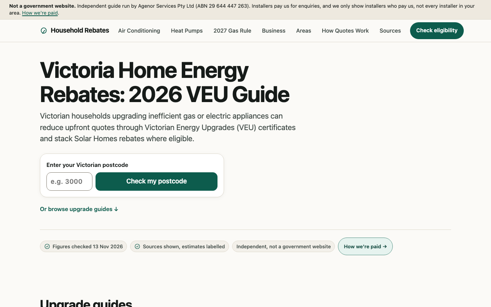

# Household Rebates

**[householdrebates.com.au](https://householdrebates.com.au)** is an independent guide to Victorian home and business energy rebates: Victorian Energy Upgrades (VEU) discounts, Solar Homes rebates, the federal battery discount, and the 1 March 2027 gas hot water rule. It includes an eligibility checker that works from your postcode.

> **Not a government website.** Run by Agenor Services Pty Ltd (ABN 29 644 447 263). Figures are indicative and dated, with their sources shown, and our own estimates are labelled. An accredited provider confirms eligibility and the final discount.



## Status (15 Nov 2026)

| | |
|---|---|
| Site | **Live**, information only: Victoria, 72 indexable pages |
| Quote form / email alerts | **Off** (`PUBLIC_LEADS_ENABLED`, `PUBLIC_ALERTS_ENABLED` = `false`). Go-live gates are in the [wiki §4](docs/README.md#4-feature-flags--go-live-gates) |
| Latest release | `20261115-1706-74a98be`: UI refresh, share images, 1-year HSTS, IndexNow ([change record](docs/change-record-2026-11-15.md)) |
| Watch item | 28 Nov 2026 Victorian election: re-check the 2027 gas-rule pages afterwards |

## Quick start

Requires Node.js 22+ (`.nvmrc` pins 24).

```bash
npm ci                                   # install site + api workspaces
npm run dev                              # Astro dev server on http://localhost:4321
npm run build                            # static site (site/dist/) + api build, with post-build checks
npm run check                            # 17 build guard scripts, astro check, unit tests, api typecheck
npm --workspace=site run test:e2e        # Playwright end-to-end + axe accessibility tests
```

## Deploy and roll back

From a clean `main`:

```bash
./ops/deploy-site.sh              # build, check, rsync, atomic switch, smoke check (auto-rollback)
INDEXNOW=1 ./ops/deploy-site.sh   # same, then notify IndexNow engines (Bing etc.)
./ops/rollback.sh site            # point the site back to the previous release
```

The scripts default to the `hostinger-vps` SSH alias. On another machine, set `VPS_HOST=user@72.61.117.132`. Details are in the [wiki §2](docs/README.md#2-architecture-deployment--rollback).

## How it's built

- **Site:** Astro 7 static build with MDX content collections, Preact islands for the checker and tools, a system font stack, and a strict `'self'`-only CSP. No trackers.
- **API:** Fastify + SQLite for quote enquiries and rule-change alerts. Built but switched off.
- **Hosting:** nginx on a VPS with atomic release switching. Backup and retention timers are defined in `ops/systemd/`.
- **Guard rails:** build scripts fail on stale or unlabelled figures, banned claims, schema errors, FAQ duplication, broken links, SEO regressions, and legal gates.

## Repository map

| Path | What's there |
|---|---|
| [`site/`](site/) | Astro site: `src/content/` (pages, guides, areas, figures, sources, FAQs), `src/components/`, `src/layouts/`, `scripts/` (build guards) |
| [`api/`](api/) | Fastify lead and alert API (off) |
| [`ops/`](ops/) | Deploy, rollback, IndexNow, backup scripts; nginx, systemd, logrotate config |
| [`docs/`](docs/) | **[Project wiki](docs/README.md)**, solution design, checker spec, URL map, legal docs, change records |
| [`prompts/`](prompts/) | Antigravity build prompts 00–42 and the [original prompt-pack index](prompts/README.md) |

## Documentation

- **[Project wiki](docs/README.md):** setup, architecture, content and figures, feature flags, legal, operations
- **[CHANGELOG](CHANGELOG.md):** one line per release
- **Change records:** [15 Nov 2026: UI refresh, SEO fixes and deployment](docs/change-record-2026-11-15.md)
- **Design and specs:** [solution design](docs/solution-design.md) · [eligibility checker spec](docs/eligibility-checker-spec.md) · [URL map](docs/url-map.md)
- **Reviews:** [business review, 14 Nov](docs/business-review-2026-11-14.md) · [legal review, 15 Nov](docs/legal/legal-review-2026-11-15.md)
- **Launch:** [Search Console and Bing setup](docs/launch/search-console-setup.md) · [go-live checklist](docs/CHECKLIST.md)

## Contributing changes

1. Write or pick a prompt in `prompts/` and work on a branch.
2. `npm run check` and `npm --workspace=site run test:e2e` must pass. Figures come only from `site/src/content/figures/`, never typed by hand.
3. Merge to `main`, add a line to [CHANGELOG.md](CHANGELOG.md) (and a dated change record in `docs/` for big releases), then deploy.
