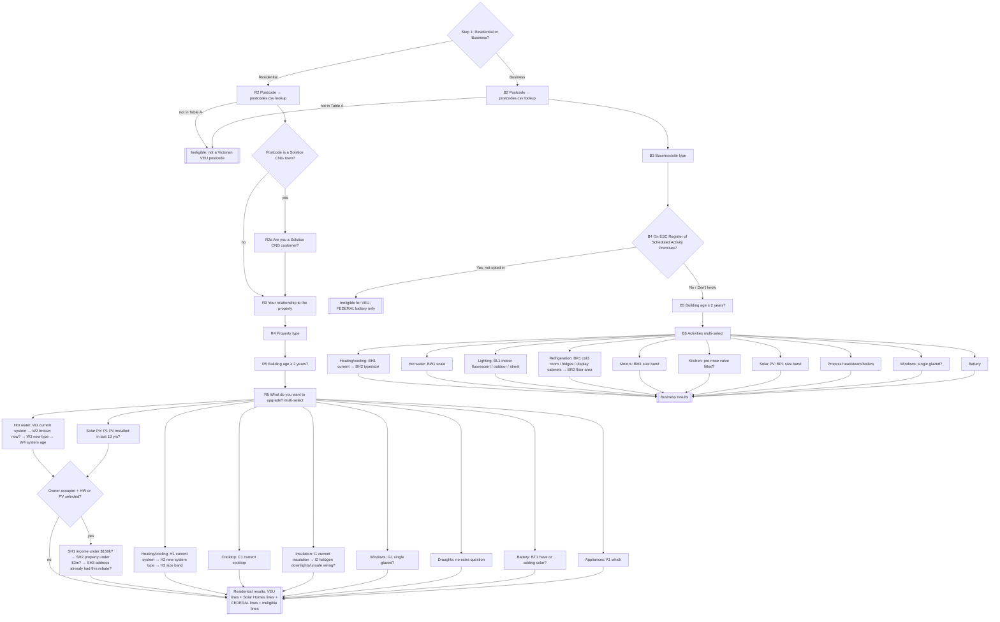

# Eligibility checker: cascading form specification

**URL:** `/victoria/eligibility-checker/` (replaces the current checker)
**Prepared:** 14 Nov 2026 (Melbourne time) by Venture Architect for Guri and Indie Builder. Specification only: no code and no prompts.
**Data files:** `postcodes.csv` (this folder), plus the site's existing `figures` and `sources` collections.
**Status words:** VERIFIED = read on the official page on the date shown. UNVERIFIED = can't be confirmed; never shown as a figure. ASSUMPTION = our own calculation, labelled on screen.

---

## 1. Principles

1. **One question per screen.** Each field shows only when an earlier answer makes it relevant under the official rules (show conditions in §4). "Back" keeps the answers already given.
2. **Step 1 is always "Residential or Business".** The two branches share only the postcode step and the result layout.
3. **The postcode drives the local figures.** One lookup in `postcodes.csv` gives `veu_area` (Metropolitan/Regional), `reticulated_gas` (Yes/No), `veu_climatic_region` (Mild/Cold/Hot), `heat_pump_zone` (4/5), `localities` and `primary_lga`. Show these back to the user as a "Your area" card ("3427 Diggers Rest · Melton council · Metropolitan · mains gas area · Mild · heat pump zone 4").
4. **Figures come from the figures collection** (value + sourceId + checkedOn) and are never typed into rules. Every figure on a result shows "Source · checked on <date>". The build blocks any figure older than MAX_FIGURE_AGE_DAYS (existing 45-day rule).
5. **VEU amounts are indicative "up to" market discounts**, set by the accredited provider and the certificate price ([Energy Vic – About VEU](https://www.energy.vic.gov.au/victorian-energy-upgrades/about)). Never present one as guaranteed. Solar Homes amounts are fixed rebates with caps. Federal programs are labelled **FEDERAL**.
6. **No personal data is stored.** Answers stay in the browser; no names, emails or addresses. The quote form stays off, so the CTA is always "read the guide" plus "find an accredited provider".
7. **Plain-language "why" on every result line**, e.g. "Because your home is more than 2 years old and you're replacing a ducted gas heater…".

---

## 2. Rules researched (what VEU actually covers)

### 2.1 Residential (households, including rentals)

| Upgrade | Who / condition | Indicative figure (Energy Vic) | Min. co-payment | Source (checked) |
|---|---|---|---|---|
| Reverse-cycle AC, room/split | Replacing system in property > 2 yrs old; 5-yr warranty for homes | Room gas heater → 3–9 kW: $630–$1,610; hard-wired electric room heater: up to $840; existing non-ducted RCAC: $210; no decommissioning: $70–$140 | $200 (single split < 10 kW) | [EVHC](https://www.energy.vic.gov.au/victorian-energy-upgrades/products/heating-and-cooling-discounts) 13 Nov 2026; [Spec v25.0 Part 6](https://www.energy.vic.gov.au/__data/assets/pdf_file/0041/795488/Victorian-Energy-Upgrades-Specifications-2018-Version-25.pdf) |
| Ducted gas → split/multi-split | as above | 4 splits (1×8 + 3×3 kW): up to $2,520; multi-split 10 kW outdoor: up to $2,940 | multi-split < 10 kW $1,000; ≥ 10 kW $3,000 (from 30 Sep 2026) | EVHC; Spec Part 6 |
| Ducted RCAC | as above | Ducted gas → 10/16/22.4 kW: up to $2,520 / $4,200 / $5,530; central electric ducted: up to $5,460; existing ducted RCAC: up to $490/$770/$910; none: up to $410 | **$3,000 for every ducted system, any capacity** (from 30 Sep 2026) | EVHC; Spec Part 6 |
| Hot water | Replace existing system in building ≥ 2 yrs old; 5-yr warranty; up to 2 systems per household | Electric → heat pump $630; electric → solar-boosted $910; gas → heat pump $560; gas → solar-boosted $700 | $200 | [EVHW](https://www.energy.vic.gov.au/victorian-energy-upgrades/products/hot-water-system-discounts) 13 Nov 2026 |
| Induction cooktop | Must have a current gas cooktop to replace (spec: premises with gas or LPG connection) | up to $140 | $200 | [EVIND](https://www.energy.vic.gov.au/victorian-energy-upgrades/products/induction-cooktop-discounts); Spec Part 46 |
| Ceiling insulation | Uninsulated or below R2.0 (~90 mm / below joist); halogen downlights or unsafe wiring = ineligible until fixed; electrical safety assessment first | up to $1,500 (150 m², metro, mild); up to $2,100 (regional, cold) | $200 | [EVINS](https://www.energy.vic.gov.au/victorian-energy-upgrades/products/insulation-discounts) 13 Nov 2026; Spec Part 48 |
| Weather sealing | All households (incl. private renters). **Not eligible** if the home has an open-flued gas space heater, an open-flued ducted heater in a cupboard, an indoor open-flued water heater or a flueless space heater | Examples by home type, 2-year / 5-year minimum warranty: apartment $70 / $140; townhouse $280 / $560; **house $350 / $700** (so 'up to $700') | — | [EVSEAL](https://www.energy.vic.gov.au/victorian-energy-upgrades/products/weather-sealing-discounts) page last updated 11 Nov 2026, checked 14 Nov 2026 |
| Window glazing | Single-glazed windows; households and most businesses | up to $210 per 10 m² | — | [EVGLAZ](https://www.energy.vic.gov.au/victorian-energy-upgrades/products/window-glazing-discounts) |
| Heat pump dryer, fridge/freezer, TV, shower head, in-home display | Households; fridge/freezer, TV and shower head also businesses (Energy Vic); clothes dryer also non-residential (ESC Part 25); in-home display residential only (ESC Part 30) | up to $70 each | — | [EVPROD](https://www.energy.vic.gov.au/victorian-energy-upgrades/products) 13 Nov 2026; [fridge page](https://www.energy.vic.gov.au/victorian-energy-upgrades/products/refrigerator-and-freezer-discounts) 14 Nov 2026 |
| Residential Efficiency Scorecard | **Closed 23 Jun 2026**; no longer a VEU activity | — | — | Spec Part 45 note |

Cross-cutting rules (VERIFIED):
- Replacement discounts need a building **more than 2 years old** (heating/cooling) or **at least 2 years old** (hot water) (EVHC, EVHW).
- Retrospective discounts are "very limited" and must be submitted within **6 months after the end of the calendar year** of the upgrade ([EVRETRO](https://www.energy.vic.gov.au/victorian-energy-upgrades/about/retrospective-discounts)).
- Renters may need landlord permission. Owners corporations are eligible as residential or commercial premises depending on building class ([EVRENT](https://www.energy.vic.gov.au/victorian-energy-upgrades/homes/renters-landlords-and-body-corporate)).
- From **1 Mar 2027** a failed gas water heater in an existing home can't be replaced with a mains-gas one (EVHW; reg 45E). Rentals: a heater that fails after 1 Mar 2027 must be replaced with an efficient RCAC in the main living area (EVHC).
- Postcode area, climate region and gas reticulation change the certificate calculation (Spec Table A note); Energy Vic's figures are averages.

### 2.2 Solar Homes (Victoria, Solar Victoria)

| Program | Eligibility (VERIFIED) | Amount | Source |
|---|---|---|---|
| Hot water rebate | Owner-occupier of an existing home; combined owners' taxable income < $150,000; property < $3m; address hasn't had a Solar Homes hot water or battery rebate; system being replaced ≥ 3 years old; eligibility approved **before** install | Up to $1,000; up to $1,400 for an eligible locally made product; calculated after other discounts (incl. VEU) | [SVHW](https://www.solar.vic.gov.au/hot-water-rebate) 13 Nov 2026; [SVINCOME](https://www.solar.vic.gov.au/solar-homes-program-continuing-provide-targeted-assistance) |
| Combined with VEU | — | Up to $1,560 off; up to $1,960 with a locally made product | EVHW |
| Solar panel (PV) rebate | Owner-occupier (existing home or under construction); income < $150,000; property < $3m; no previous Solar Homes PV/battery rebate at the address; no PV installed there in the last 10 years; approval before install | Up to $1,400 plus optional interest-free loan of the same amount | [SVPV](https://www.solar.vic.gov.au/solar-panel-rebate) 13 Nov 2026 |
| PV for rentals | Rental properties are eligible and the $150,000 cap applies to rentals too | Details of landlord/tenant criteria: **UNVERIFIED** (show "see Solar Victoria") | SVPV; SVINCOME |
| PV transition | PV support moves into VEU from **1 Jul 2027**; current arrangements stay until 30 Jun 2027 | — | [SVPVVEU](https://www.solar.vic.gov.au/solar-support-continue-through-victorian-energy-upgrades-program) |
| Solstice CNG towns | No income cap; hot water of any age; $600 top-up when VEU rules (home < 2 yrs, recent system) aren't met | — | [SVSOL](https://www.solar.vic.gov.au/supporting-solstice-customers) |
| Victorian battery rebate | Not offered on the Solar Victoria pages checked | **UNVERIFIED**: don't show | — |

### 2.3 Federal (label **FEDERAL** on screen)

| Program | Rule (VERIFIED) | Amount shown | Source |
|---|---|---|---|
| Cheaper Home Batteries | Households, businesses and community organisations; small-scale batteries 5–100 kWh, connected to new or existing solar PV; accredited installer; discount via STCs | "around 30% off the upfront cost". From 1 May 2026 the STC factor tapers: 100% up to 14 kWh, 60% for 14–28 kWh, 15% for 28–50 kWh | [DCCEEW](https://www.dcceew.gov.au/energy/programs/cheaper-home-batteries) (9 Jun 2026); [CER](https://cer.gov.au/news-and-media/media/2026/march/battery-rebates-are-changing-1-may-2026) |
| STCs on heat pump / solar water heaters | Heat pumps < 425 L on the CER register | Amount: provider includes it (not calculated here) | [CER](https://cer.gov.au/schemes/renewable-energy-target/small-scale-renewable-energy-scheme/small-scale-renewable-energy-systems/solar-water-heaters-and-air-source-heat-pumps) |
| STCs on small solar PV | SRES applies to small systems; C&I 30–100 kW may claim STCs, > 100 kW LGCs | Amount: **not calculated** (UNVERIFIED for homes on this site) | [EVCIPV](https://www.energy.vic.gov.au/victorian-energy-upgrades/products/solar-pv) |

### 2.4 Business (VEU). Verified scope

Energy Vic's business page lists "hot water, space heating and cooling, refrigeration, to custom upgrades" ([EVBIZ](https://www.energy.vic.gov.au/victorian-energy-upgrades/businesses), updated 17 Aug 2026). The products page lists these business-only products: **commercial and industrial lighting, C&I solar PV, cold rooms, pre-rinse spray valves, high-efficiency motors** (EVPROD). Spec v25.0 also prescribes refrigerated cabinets (Part 32), refrigeration/ventilation fan motors (Part 33), public lighting (Part 27, councils and road authorities), gas boiler, burner and steam activities (Parts 37–42) and C&I heat pump water heaters (Part 44, "commercial (including multi-residential) and industrial").

| Activity (Guri's list) | Covered? | Indicative figures | Min. contribution | Source (checked 14 Nov 2026 unless noted) |
|---|---|---|---|---|
| Space heating/cooling | Yes, all businesses | Non-ducted gas → 3–9 kW: $420–$1,050; ducted gas → 4 splits: up to $1,680; multi-split 10 kW: up to $1,820; ducted gas → ducted 16/25/32/56 kW: up to $2,590 / $3,850 / $6,230 / $8,820; central electric ducted 16–56 kW: up to $4,060; existing ducted RCAC: $910–$3,290; no decommissioning: up to $1,820 (ducted) / $70–$140 (room); hard-wired electric room heater: up to $490 | Same Part 6 co-payments as homes ($3,000 any ducted) | EVHC (13 Nov 2026); Spec Part 6 |
| Hot water | Yes: up to 5 standard systems; larger C&I heat pumps with no limit | Standard: same table as homes; C&I: no consumer figure | $200; **$10,000** for larger C&I | EVHW (13 Nov); Spec Part 44 |
| Lighting | Yes: outdoor/C&I; indoor **only if existing lights are fluorescent**; street lighting for councils/road authorities | Examples: 100 × 24 W tubes → 50 LED: $1,260; 20 metal halide car park → LED high bays: $3,150 | — | [EVLIGHT](https://www.energy.vic.gov.au/victorian-energy-upgrades/products/lighting-discounts) |
| Refrigeration: cold rooms | Yes: walk-in, ≥ 4 m² floor, < 7 °C or freezer | Small/medium/large: $420 / $1,540 / $4,620 | $500 | [EVCOLD](https://www.energy.vic.gov.au/victorian-energy-upgrades/products/cold-room-discounts) |
| Refrigeration: fridges/freezers | Yes (household-type units, 250–700 L, star-rating thresholds) | up to $70 | — | EVFRIDGE |
| Refrigerated display cabinets, fan motors | Spec activities exist (Parts 32–33) | **No consumer figure published.** Provider confirms | — | Spec v25.0 |
| Motors | Yes | Up to $2,380 (185 kW premium); e.g. 75 kW high-efficiency $560 | $200 | [EVMOTOR](https://www.energy.vic.gov.au/victorian-energy-upgrades/products/upgrade-your-motor) |
| Commercial kitchens | Pre-rinse spray valves | $210 each | — | [EVPRV](https://www.energy.vic.gov.au/victorian-energy-upgrades/products/pre-rinse-spray-valve-discounts) |
| Solar PV | Yes: non-residential, 30–200 kW, ≥ 30 kVA inverter, one per NMI | 50/75/100/150/200 kW: $4,550 / $6,860 / $9,100 / $25,760 / $34,300 (at $70 VEEC) | — | EVCIPV |
| Process heat, steam, boilers, industrial HVAC/refrigeration, > 200 kW PV | Custom (M&V) or project-based activities | No figure. Needs an M&V professional | — | [EVBIZCUST](https://www.energy.vic.gov.au/victorian-energy-upgrades/businesses/custom-upgrades) (14 Apr 2026) |
| Windows | "Most businesses" with single glazing | up to $210 per 10 m² | — | EVGLAZ |
| Insulation, induction, in-home display, weather sealing | Residential only: ESC lists Parts 15 (weather sealing), 30 (in-home display), 46 (induction) and 48 (ceiling insulation) as residential-only | — | — | [ESC overview of VEU activities](https://www.esc.vic.gov.au/victorian-energy-upgrades-program/about-victorian-energy-upgrades-program/overview-veu-activities) checked 14 Nov 2026; EVINS, EVIND, EVSEAL |
| Heat pump clothes dryer | **Not residential-only** (corrected 14 Nov 2026): ESC lists Part 25 clothes dryers for residential and non-residential premises; Energy Vic's product page gives no business wording, so for a business show "Possibly; provider confirms" | up to $70 (EVPROD) | — | ESC overview of VEU activities; EVPROD |
| Batteries | **FEDERAL** Cheaper Home Batteries covers businesses (5–100 kWh) | ~30% | — | DCCEEW |

**Business exclusion (VERIFIED):** large energy-consuming sites on the ESC **Register of Scheduled Activity Premises** can't take part unless they opt in (EVBIZ).
**Small business savings framing:** "small businesses can save up to $500 a year, larger businesses up to $74,000" (EVBIZ).

---

## 3. Decision tree

---

## 4. Steps and fields

Notation: **Show when** uses earlier field IDs. "Any" = always shown on that branch. All single-choice fields are required unless marked optional. Every choice list includes "Not sure" where noted; "Not sure" never blocks a result but adds a "provider confirms" caveat.

### 4.0 Shared

| ID | Label | Type | Options | Validation | Show when |
|---|---|---|---|---|---|
| S1 | Is this for a home or a business? | Single choice (cards) | Residential (my home, a rental I own or rent, an apartment) · Business (shop, office, factory, farm, school, community building) | Required | Always (Step 1) |

### 4.1 Residential branch

| ID | Label | Type | Options | Validation | Show when |
|---|---|---|---|---|---|
| R2 | What's the postcode of the property? | Text, numeric keypad | — | Exactly 4 digits; must start with 3 (Victoria) and exist in postcodes.csv; otherwise message X1. On match, show the "Your area" card (localities, primary_lga and other_lgas, veu_area, reticulated_gas, climate, heat pump zone) | S1 = Residential |
| R2a | Are you a customer of Solstice Energy's compressed natural gas network? | Yes / No / Not sure | — | Required | R2 ∈ {3515, 3523, 3585, 3549, 3463, 3579, 3638, 3264, 3909, 3888} (Solstice towns, see url-map) |
| R3 | What's your connection to the property? | Single choice | I own it and live in it · I own it and rent it out (landlord) · I rent it (tenant) · Owners corporation / body corporate · I'm building it (under construction) | Required | S1 = Residential |
| R4 | What type of home is it? | Single choice | House or townhouse · Apartment or unit in a multi-storey building · Other / not sure | Required | R3 ≠ "building it" |
| R5 | Is the building more than 2 years old? | Yes / No / Not sure | Helper: "Count from when the home was first finished, not when you moved in." | Required | R3 ≠ "building it" |
| R6 | What would you like to upgrade? | Multi-select | Heating and cooling · Hot water · Cooktop · Ceiling insulation · Draughts (weather sealing) · Windows · Solar panels · Home battery · Appliances (fridge, dryer, TV, shower head, energy display) | ≥ 1 selected. If R3 = "building it", offer only Solar panels and Home battery (new-home PV is in SVPV; VEU replacement rules need an existing building) | S1 = Residential |
| H1 | What heats your home now? | Single choice | Ducted gas heater · Gas room heater (wall/space) · Electric heater hard-wired in a room · Central electric ducted heater · Reverse-cycle split/room unit · Ducted reverse-cycle · Nothing / portable heaters only · Not sure | Required | "Heating and cooling" ∈ R6 |
| H2 | What would you like to install? | Single choice | Split system(s) (one room) · Several splits or a multi-split · Ducted reverse-cycle | Required | "Heating and cooling" ∈ R6 |
| H3 | Rough size, if you know it | Single choice (optional) | Under 10 kW · 10 kW or more · Not sure | Optional; drives co-payment line | H2 ∈ {multi-split} (ducted co-payment doesn't depend on size) |
| W1 | What hot water system do you have now? | Single choice | Gas (mains), storage or instant · LPG (bottled gas) · Electric storage tank · Solar, working · Solar, broken/out of warranty · Heat pump already · Not sure | Required | "Hot water" ∈ R6 |
| W2 | Has it stopped working? | Yes / No | Helper explains the 1 Mar 2027 rule | Required | "Hot water" ∈ R6 and W1 ∈ {Gas (mains), LPG} |
| W3 | What would you like instead? | Single choice | Heat pump · Solar-boosted · Not sure | Required | "Hot water" ∈ R6 and W1 ≠ "Heat pump already" |
| W4 | Is your current system at least 3 years old? | Yes / No / Not sure | — | Required | "Hot water" ∈ R6 and R3 = "own and live in it" and R2a ≠ Yes (Solstice: any age) |
| C1 | What cooktop do you have now? | Single choice | Gas (mains) · LPG (bottled) · Electric (coil/ceramic) · Already induction | Required | "Cooktop" ∈ R6 |
| I1 | What's in your ceiling now? | Single choice | Nothing · Thin or patchy (about 90 mm or lower than the joists) · Thick, well-fitted insulation · Can't access / not sure | Required | "Ceiling insulation" ∈ R6 and R4 ≠ "Apartment" (if apartment, show I-APT note instead) |
| I2 | Do you have halogen downlights or any known wiring problems? | Yes / No / Not sure | — | Required | "Ceiling insulation" ∈ R6 and I1 ∈ {Nothing, Thin, Not sure} |
| G1 | Are your windows single-glazed? | Yes / No / Some / Not sure | — | Required | "Windows" ∈ R6 |
| P1 | Has solar been installed at this address in the last 10 years? | Yes / No / Not sure | — | Required | "Solar panels" ∈ R6 |
| BT1 | Do you have solar panels, or are you adding them? | Have solar · Adding solar now · No solar | — | Required | "Home battery" ∈ R6 |
| A1 | Which appliances? | Multi-select | Heat pump clothes dryer · Fridge or freezer · TV · Shower head · In-home energy display | ≥ 1 | "Appliances" ∈ R6 |
| SH1 | Is the combined taxable income of all owners under $150,000 a year? | Yes / No / Not sure | Helper: "This is a Solar Victoria rule, not a VEU rule." | Required | R3 ∈ {own and live, building it (PV only), landlord (PV only)} and ("Hot water" ∈ R6 or "Solar panels" ∈ R6) and R2a ≠ Yes |
| SH2 | Is the property worth less than $3 million? | Yes / No / Not sure | — | Required | SH1 shown |
| SH3 | Has this address already had a Solar Homes rebate for the same thing (or a solar battery rebate)? | Yes / No / Not sure | — | Required | SH1 shown or R2a = Yes |

### 4.2 Business branch

| ID | Label | Type | Options | Validation | Show when |
|---|---|---|---|---|---|
| B2 | Postcode of the site | Text, numeric | — | As R2 (message X1) | S1 = Business |
| B3 | What kind of site is it? | Single choice | Office or retail · Hospitality / food · Warehouse, factory or industrial · Farm or agriculture · School, hospital, community or not-for-profit · Apartment building common areas (owners corporation) · Council / public lighting authority | Required | S1 = Business |
| B4 | Is the site on the ESC Register of Scheduled Activity Premises (Victoria's largest energy users)? | Yes, and we haven't opted in · Yes, and we've opted in · No · Not sure | Helper links to the ESC register (via EVBIZ) | Required | B3 ≠ Council |
| B5 | Is the building more than 2 years old? | Yes / No / Not sure | — | Required | S1 = Business |
| B6 | What would you like to upgrade? | Multi-select | Heating and cooling · Hot water · Lighting · Refrigeration · Motors · Commercial kitchen spray valves · Solar panels (30 kW+) · Process heat, steam or boilers · Windows · Battery | ≥ 1. Hide "Lighting → street lighting" unless B3 = Council | B4 ≠ "Yes, not opted in" (if so, only Battery is offered) |
| BH1 | What heats/cools the space now? | Single choice | Ducted gas · Non-ducted gas heater · Hard-wired electric room heater · Central electric ducted · Non-ducted reverse-cycle · Ducted reverse-cycle · Nothing | Required | "Heating and cooling" ∈ B6 |
| BH2 | What would you install? | Single choice | Room split 3–9 kW · Several splits / multi-split · Ducted 16 kW · 25 kW · 32 kW · 56 kW · Not sure | Required | "Heating and cooling" ∈ B6 |
| BW1 | How big is the hot water need? | Single choice | Household-size units (how many? 1–5) · Larger commercial/industrial system | Required; count 1–5 integer if first option | "Hot water" ∈ B6 |
| BW2 | Current system | Single choice | Gas · Electric · Solar (broken) · None (new installation) | Required | "Hot water" ∈ B6 |
| BL1 | Which lights? | Multi-select | Indoor fluorescent tubes · Indoor other (LED, halogen, metal halide indoors) · Outdoor / car park / sports ground · Street lighting | ≥ 1 | "Lighting" ∈ B6 |
| BR1 | Which refrigeration? | Multi-select | Walk-in cold room · Fridge/freezer (household-type) · Display cabinets · Refrigeration fan motors | ≥ 1 | "Refrigeration" ∈ B6 |
| BR2 | Cold room internal floor area | Single choice | Under 4 m² · 4–9 m² · Over 9 to under 24 m² · 24 m² or more | Required | "Walk-in cold room" ∈ BR1 |
| BR3 | Does it store goods below 7 °C or run as a freezer? | Yes / No | — | Required | "Walk-in cold room" ∈ BR1 |
| BM1 | Motor size | Single choice | Under 15 kW · 15–75 kW · 75–185 kW · Over 185 kW | Required | "Motors" ∈ B6 |
| BK1 | Is a pre-rinse spray valve (or a fitting for one) already installed? | Yes / No | — | Required | "Commercial kitchen spray valves" ∈ B6 |
| BP1 | Planned solar size | Single choice | Under 30 kW · 30–50 · 50–100 · 100–200 · Over 200 kW | Required | "Solar panels" ∈ B6 |
| BG1 | Are the windows single-glazed? | Yes / No / Some | — | Required | "Windows" ∈ B6 |

---

## 5. Outcome rules

Each rule produces one result line: **status** (Likely eligible / Possibly eligible (provider confirms) / Not eligible), **figure** (from the figures collection), **why**, **source + checked-on**, and the CTA from §7. Lines are grouped as **VEU (Victoria)**, **Solar Homes (Victoria)**, **FEDERAL**.

### 5.1 Global modifiers (apply to every residential and business VEU line)

| ID | Condition | Effect |
|---|---|---|
| G-AREA | Always | Add: "Your postcode is {veu_area}, {veu_climatic_region} climate. VEU discounts are calculated for your area, so the provider's figure may differ from Energy Vic's average." (Spec Table A) |
| G-NOTSURE | Any "Not sure" in a gating field | Downgrade status to "Possibly eligible (provider confirms)" |
| G-AGE | R5/B5 = No and the line is a *replacement* (heating/cooling, hot water) | Not eligible (message N-AGE), unless R2a = Yes (Solstice $600 top-up, see SOL-2) |
| G-RETRO | Always (footer) | "Talk to an accredited provider **before** you buy. Discounts after installation are rare and must be lodged within 6 months after the end of the calendar year." (EVRETRO, checked 13 Nov 2026) |
| G-RENT | R3 = tenant | Add: "You may need your landlord's permission" (EVRENT) to every installed-product line |
| G-OC | R3 = owners corporation | Add: "Eligible as residential or commercial premises depending on building class. Provider confirms." (EVRENT) |
| G-SCHED | B4 = "Yes, not opted in" | All business VEU lines → Not eligible (N-SCHED) |
| G-SCAM | Always (footer) | Link /victoria/veu-scams-cold-calls/ |

### 5.2 Residential rules

| ID | Condition | Status / figure (checked) | Why text |
|---|---|---|---|
| RH-1 | H1 = Gas room heater, H2 = Split | Likely; $630–$1,610 (EVHC, 13 Nov 2026); co-pay $200 (Spec Part 6) | Replacing a non-ducted gas heater with an efficient RCAC |
| RH-2 | H1 = Ducted gas, H2 = Ducted | Likely; up to $2,520 (10 kW) / $4,200 (16 kW) / $5,530 (22.4 kW) as a table, never "$5,530" alone (EVHC); **co-pay $3,000 incl GST** (Spec Part 6, from 30 Sep 2026) | Ducted gas → ducted RCAC |
| RH-3 | H1 = Ducted gas, H2 = Several splits/multi-split | Likely; 4 splits up to $2,520; multi-split 10 kW up to $2,940 (EVHC); co-pay $1,000 if < 10 kW, $3,000 if ≥ 10 kW; if H3 = Not sure, show both | Ducted gas → splits |
| RH-4 | H1 = Hard-wired electric room heater, H2 = Split | Likely; up to $840 (EVHC); co-pay $200 | — |
| RH-5 | H1 = Central electric ducted, H2 = Ducted | Likely; up to $5,460 (EVHC); co-pay $3,000 | — |
| RH-6 | H1 = Reverse-cycle split, H2 = Split | Likely; $210 (EVHC); co-pay $200 | Upgrading an older RCAC |
| RH-7 | H1 = Ducted RCAC, H2 = Ducted | Likely; up to $490 / $770 / $910 (EVHC); co-pay $3,000 | — |
| RH-8 | H1 = Nothing/portable | Possibly; split $70–$140, ducted up to $410 (EVHC) | No product decommissioned |
| RH-9 | Any RH line and R3 = landlord | Add: "From 1 Mar 2027, a rental heater that fails must be replaced by an efficient RCAC in the main living area" (EVHC) | — |
| RW-1 | W1 = Gas (mains), W3 = Heat pump | Likely; $560 (EVHW, 13 Nov 2026); co-pay $200 | — |
| RW-2 | W1 = Gas (mains), W3 = Solar-boosted | Likely; $700 (EVHW) | — |
| RW-3 | W1 = Electric storage, W3 = Heat pump | Likely; $630 (EVHW) | — |
| RW-4 | W1 = Electric storage, W3 = Solar-boosted | Likely; $910 (EVHW) | — |
| RW-5 | W1 = Solar, broken | Possibly; use the gas or electric line for the booster type (EVHW footnote: some gas- and electric-boosted solar heaters count) | — |
| RW-6 | W1 = LPG | Possibly; **figure UNVERIFIED** ("Spec Part 3 covers gas or LPG water heaters; Energy Vic publishes only a gas figure, so your provider confirms the amount") | — |
| RW-7 | W1 = Solar, working, or Heat pump already | Not eligible (N-HW-EFF) | — |
| RW-8 | W1 = Gas (mains) and W2 = Yes | Add a 2027-rule banner: "From 1 Mar 2027 a failed gas water heater in an existing home must be replaced with an electric system. Before then you can still choose." (EVHW; reg 45E). Link /victoria/gas-hot-water-broken-before-or-after-march-2027/ and /victoria/gas-hot-water-ban-exemptions/ | — |
| RW-9 | Any RW line | Add: "Households can upgrade up to 2 systems; 5-year warranty required" (EVHW) | — |
| RC-1 | C1 ∈ {Gas, LPG} | Likely; up to $140 (EVIND); co-pay $200 (Spec Part 46). If C1 = Gas and all other gas uses are going: "Removing all gas appliances can save about $350–$400 a year in supply charges" (EVIND) | — |
| RC-2 | C1 ∈ {Electric, Induction} | Not eligible (N-COOK) | — |
| RI-1 | I1 ∈ {Nothing, Thin} and I2 = No | Likely; figure by postcode: Metropolitan+Mild → "up to $1,500" (EVINS); Regional+Cold → "up to $2,100" (EVINS); other combinations → "about $X (estimate)" with X from §5.4 labelled ASSUMPTION; co-pay $200 (Spec Part 48). Add the electrical safety assessment step (EVINS) | — |
| RI-2 | I2 = Yes | Not eligible yet (N-INS-SAFE) | — |
| RI-3 | I1 = Thick | Not eligible (N-INS-R2) | — |
| RI-4 | I1 = Not sure | Possibly; same figure as RI-1 | — |
| RI-5 | R3 = landlord | Add: "From 1 Mar 2027, rentals at a new lease need R5.0 ceiling insulation where none is present" (EVRENTAL) | — |
| I-APT | "Ceiling insulation" ∈ R6 and R4 = Apartment | Possibly; "Only if your unit has an accessible ceiling space under the roof. Provider confirms." | — |
| RD-1 | "Draughts" ∈ R6 | Likely; Energy Vic examples by home type, each shown as 2-year / 5-year minimum warranty: R4 = Apartment → "up to $70 / $140"; R4 = House or townhouse → "townhouse example up to $280 / $560; house example up to $350 / $700"; R4 = Other / not sure → all three examples (EVSEAL, page updated 11 Nov 2026); renters eligible. Never show $700 alone | — |
| RD-2 | "Draughts" ∈ R6 and H1 ∈ {Ducted gas heater, Gas room heater} or not asked | Add caveat N-SEAL-GAS: "Homes with open-flued or flueless gas heaters, or an indoor open-flued water heater, can't get the weather sealing discount (carbon monoxide risk). The provider checks your appliances first." (EVSEAL) | — |
| RG-1 | G1 ∈ {Yes, Some} | Likely; up to $210 per 10 m² (EVGLAZ) | — |
| RG-2 | G1 = No | Not eligible (N-GLAZE) | — |
| RA-1 | per A1 item | Likely; up to $70 each (EVPROD) | — |
| SH-HW | "Hot water" ∈ R6, R3 = own+live, SH1 = Yes, SH2 = Yes, SH3 = No, W4 = Yes, W1 ≠ efficient | Likely; Solar Homes up to $1,000 ($1,400 locally made), applied after VEU; combined with VEU up to $1,560 / $1,960 (SVHW, EVHW). **Apply and get approval before installing** (SVHW) | — |
| SH-HW-X | Any SH-HW condition false | Not eligible for Solar Homes; give the reason: N-SH-INC / N-SH-PROP / N-SH-DUP / N-SH-AGE / N-SH-TENURE. The VEU line still stands | — |
| SH-PV | "Solar panels" ∈ R6, R3 ∈ {own+live, building it}, SH1 = Yes, SH2 = Yes, SH3 = No, P1 = No | Likely; up to $1,400 plus optional matching interest-free loan (SVPV). Banner: "PV support moves into VEU from 1 Jul 2027; current rebates continue to 30 Jun 2027" (SVPVVEU) | — |
| SH-PV-L | "Solar panels" ∈ R6, R3 = landlord | Possibly; "Solar Victoria offers a rental PV rebate and the $150,000 cap applies; landlord/tenant criteria: see Solar Victoria" (criteria UNVERIFIED) | — |
| SH-PV-X | P1 = Yes, or SH1/SH2/SH3 fail | Not eligible (N-PV-10Y or the income/property/duplicate message) | — |
| FED-BAT | "Home battery" ∈ R6 and BT1 ∈ {Have solar, Adding solar} | **FEDERAL** Likely; "around 30% off; 5–100 kWh; the rebate tapers above 14 kWh (60% to 28 kWh, 15% to 50 kWh) since 1 May 2026" (DCCEEW 9 Jun 2026; CER) | — |
| FED-BAT-X | BT1 = No solar | Not eligible (N-BAT-SOLAR) | — |
| FED-STC | W3 = Heat pump or Solar-boosted | **FEDERAL** add: "Small-scale technology certificates may also reduce the price (heat pumps under 425 L on the CER register). Your installer applies them." (CER) | — |
| SOL-1 | R2a = Yes | Banner: Solstice exemptions (no income cap; any-age hot water; rental providers eligible; $600 top-up where VEU rules aren't met) (SVSOL); link /victoria/solstice-gas-shutdown-towns/ | — |
| SOL-2 | R2a = Yes and G-AGE would fail | Replace N-AGE with "Possibly: the Solstice $600 top-up may apply" (SVSOL) | — |
| GAS-NO | reticulated_gas = No and W1/C1/H1 is a mains-gas option | Soft prompt: "Your postcode is listed as having no mains gas. Did you mean LPG?" (Spec Table A); don't block | — |
| HPZ-5 | heat_pump_zone = 5 and "Hot water" ∈ R6 | Info: "Your postcode is heat pump zone 5 (colder). VEU uses zone-5 values for your area" (Spec Table A) | — |

### 5.3 Business rules

| ID | Condition | Status / figure (checked) |
|---|---|---|
| BH-1..7 | BH1 × BH2 combinations as in the EVHC business table | Likely; non-ducted gas → room $420–$1,050; ducted gas → 4 splits up to $1,680, multi-split up to $1,820; ducted gas → 16/25/32/56 kW up to $2,590 / $3,850 / $6,230 / $8,820; central electric ducted up to $4,060; existing ducted RCAC $910 / $1,400 / $3,010 / $3,290; non-ducted RCAC $210–$490; hard-wired electric room heater up to $490; none: room $70–$140, ducted up to $1,820 (EVHC, 13 Nov 2026). Same Part 6 co-payments ($3,000 any ducted) |
| BW-1 | BW1 = household-size, count ≤ 5 | Likely; standard hot water figures ($560–$910) (EVHW); co-pay $200 each |
| BW-2 | BW1 = household-size, count > 5 | Possibly; "up to 5 systems; above that, ask about the commercial and industrial activity" (EVHW) |
| BW-3 | BW1 = Larger C&I | Possibly; no published figure; **$10,000 minimum contribution**; no limit on number (EVHW; Spec Part 44) |
| BL-1 | "Indoor fluorescent" ∈ BL1 | Likely; example 100 tubes → 50 LED $1,260 (EVLIGHT, 14 Nov 2026) |
| BL-2 | "Outdoor/car park/sports" ∈ BL1 | Likely; example 20 metal halide → LED high bays $3,150 (EVLIGHT) |
| BL-3 | "Street lighting" ∈ BL1 and B3 = Council | Likely; example 100 street lights $21,350 (EVLIGHT) |
| BL-4 | "Indoor other" only | Not eligible (N-LIGHT) |
| BR-1 | Cold room, BR3 = Yes, BR2 ≥ 4 m² | Likely; small (4–9 m²) EEV + controller $420; medium 3-part $1,540; large 5-part $4,620; **$500 minimum contribution** (EVCOLD, 25 Aug 2026 page) |
| BR-2 | BR2 = Under 4 m² or BR3 = No | Not eligible (N-COLD) |
| BR-3 | Fridge/freezer | Likely; up to $70; 250–700 L, ≥ 5.5 stars (fridge) / ≥ 4 stars (freezer) (EVFRIDGE) |
| BR-4 | Display cabinets or fan motors | Possibly; "a VEU activity (Spec Parts 32–33) with no published consumer figure. Provider confirms" |
| BM-1 | BM1 ≤ 185 kW | Likely; e.g. 15 kW premium $280; 75 kW high-efficiency $560 / premium $1,120; 185 kW up to $2,380; **$200 minimum** (EVMOTOR, 16 Jun 2026 page) |
| BM-2 | BM1 = Over 185 kW | Possibly; "above the published examples; ask about a custom (M&V) upgrade" (EVBIZCUST) |
| BK-1 | BK1 = Yes | Likely; $210 per valve (EVPRV) |
| BK-2 | BK1 = No | Not eligible (N-PRV) |
| BP-1 | BP1 ∈ 30–200 kW and B3 ≠ apartment common areas | Likely; 50 kW $4,550, 75 kW $6,860, 100 kW $9,100, 150 kW $25,760, 200 kW $34,300 at a $70 VEEC (EVCIPV, 11 Nov 2026 page). Note STCs (≤ 100 kW) or LGCs (> 100 kW) may add (EVCIPV) |
| BP-2 | BP1 = Under 30 kW | Not eligible for VEU C&I solar (N-PV-30) |
| BP-3 | BP1 = Over 200 kW | Possibly; custom M&V route (EVCIPV, EVBIZCUST) |
| BX-1 | "Process heat…" ∈ B6 | Possibly; "custom upgrades (process heat and steam, HVAC, refrigeration, fans and motors, renewables) via M&V; needs a qualified professional" (EVBIZCUST); no figure |
| BG-1 | BG1 ∈ {Yes, Some} | Likely ("most businesses"); up to $210 per 10 m² (EVGLAZ) |
| BB-1 | Battery | **FEDERAL** Likely; Cheaper Home Batteries covers businesses, 5–100 kWh, ~30% (DCCEEW) |
| B-RES-ONLY | User asks about insulation/induction/IHD/weather sealing | Not offered in the business list (N-BIZ-RES). A business asking about a heat pump dryer gets "Possibly; up to $70; provider confirms" (ESC Part 25 covers non-residential) |
| B-OC | B3 = apartment common areas | Route hot water to BW-3 wording ("commercial (including multi-residential)", Spec Part 44); lighting common areas Possibly (Spec Part 34 lists Class 2 common areas) |

### 5.4 Insulation figure by postcode (ASSUMPTION derivation, shown labelled)

Spec v25.0 Part 48: reduction = GHG savings (Mild 0.00576 / Cold 0.00771 / Hot 0.00546) × area × 25 × regional factor (Metropolitan 0.98 / Regional 1.04). Energy Vic's two published examples anchor the scale: metro mild $1,500 and regional cold $2,100 (the formula gives $2,131, consistent). For the same 150 m² house:

| veu_area + climate (postcodes in Table A) | Shown as |
|---|---|
| Metropolitan + Mild (258) | "up to $1,500" (Energy Vic) |
| Regional + Cold (245) | "up to $2,100" (Energy Vic) |
| Regional + Mild (146, e.g. Geelong, Latrobe Valley, Bacchus Marsh) | "about $1,590 (our estimate)" |
| Metropolitan + Cold (23, e.g. New Gisborne 3438, Riddells Creek 3431, Dandenong Ranges) | "about $2,010 (our estimate)" |
| Regional + Hot (47, e.g. Mildura, Swan Hill) | "about $1,510 (our estimate)" |

---

## 6. Ineligible and caution messages

| ID | Message (plain English) | Link |
|---|---|---|
| X1 | "That postcode isn't in the Victorian Energy Upgrades postcode list, so we can't check it. VEU only covers Victoria. Check the number, or try a nearby postcode." | /victoria/postcode/ |
| N-AGE | "Most VEU replacement discounts need a building more than 2 years old. Newer homes, including new estate homes, usually can't get the heating, cooling or hot water replacement discounts yet." | /victoria/new-homes-all-electric-2027/ |
| N-HW-EFF | "You already have an efficient system (working solar or a heat pump), so there's no VEU discount to replace it." | /victoria/gas-hot-water-to-heat-pump/ |
| N-COOK | "The VEU cooktop discount is for replacing a gas or LPG cooktop." | /victoria/gas-cooktop-to-induction/ |
| N-INS-SAFE | "Homes with halogen downlights or unsafe wiring can't get the insulation discount until a licensed electrician fixes them. After that, you can apply." | /victoria/ceiling-insulation-rebate/ |
| N-INS-R2 | "The discount is for ceilings with no insulation or insulation below R2.0 (about 90 mm)." | /victoria/ceiling-insulation-rebate/ |
| N-GLAZE | "Window discounts are for single-glazed windows." | /victoria/draught-proofing-rebate/ |
| N-SEAL-GAS | "Homes with open-flued or flueless gas heaters, or an indoor open-flued water heater, can't get the weather sealing discount (carbon monoxide risk). The provider checks your appliances first." | /victoria/draught-proofing-rebate/ |
| N-SH-INC | "Solar Homes rebates need a combined owners' taxable income under $150,000 a year (since 1 Jul 2026). VEU discounts have no income test, so they still apply." | /victoria/veu-vs-solar-homes/ |
| N-SH-PROP | "Solar Homes rebates need a property worth under $3 million." | /victoria/veu-vs-solar-homes/ |
| N-SH-DUP | "This address has already had this Solar Homes rebate (or a solar battery rebate), so it can't get another." | /victoria/can-you-claim-veu-twice/ |
| N-SH-AGE | "The Solar Homes hot water rebate needs the old system to be at least 3 years old." | /victoria/heat-pump-rebate/ |
| N-SH-TENURE | "The Solar Homes hot water rebate is for owner-occupiers. Tenants and landlords can still use VEU discounts." | /victoria/renters/ · /victoria/landlords-rental-standards-2027/ |
| N-PV-10Y | "The Solar Homes PV rebate isn't available where solar was installed in the last 10 years." | /victoria/veu-vs-solar-homes/ |
| N-BAT-SOLAR | "The federal battery discount is for batteries connected to new or existing solar panels." | /victoria/veu-vs-solar-homes/ |
| N-SCHED | "Sites on the ESC Register of Scheduled Activity Premises can't use VEU unless they opt in. Check the register or ask the ESC." | /victoria/business-energy-upgrades/ |
| N-LIGHT | "Indoor business lighting discounts now apply only when replacing fluorescent lights." | /victoria/business-energy-upgrades/ |
| N-COLD | "Cold room discounts need a walk-in room of at least 4 m² that stores goods below 7 °C or runs as a freezer." | /victoria/business-energy-upgrades/ |
| N-PRV | "You need an existing pre-rinse spray valve, or a fitting for one." | /victoria/business-energy-upgrades/ |
| N-PV-30 | "VEU business solar discounts are for systems of 30–200 kW. Smaller systems may still get federal STCs through your installer." | /victoria/business-energy-upgrades/ |
| N-BIZ-RES | "Ceiling insulation, induction cooktops, weather sealing and in-home displays are household-only VEU products." | /victoria/business-energy-upgrades/ |
| N-NONE | All lines ineligible: "Nothing matched this time. Here's why, line by line. Rules change often; we last checked them on {date}." | /victoria/ |

---

## 7. CTA per outcome (quote form stays off)

| Outcome | Primary CTA | Secondary |
|---|---|---|
| Any residential VEU line Likely/Possibly | "Get 2–3 quotes from VEU accredited providers before you buy" → /victoria/find-an-accredited-provider/ | The matching guide: RH-1 → /victoria/gas-room-heater-to-split-system/; RH-2 → /victoria/ducted-gas-to-ducted-reverse-cycle/; RH-3 → /victoria/ducted-gas-to-split-systems/; RH-4/5 → /victoria/electric-heater-to-reverse-cycle/; RW-1/2 → /victoria/gas-hot-water-to-heat-pump/; RW-3/4 → /victoria/electric-hot-water-to-heat-pump/; RW-5 → /victoria/solar-hot-water-rebate/; RC-1 → /victoria/gas-cooktop-to-induction/; RI → /victoria/ceiling-insulation-rebate/; RD/RG → /victoria/draught-proofing-rebate/ |
| Co-payment shown ($1,000/$3,000) | "What the minimum co-payment means" → /victoria/veu-minimum-co-payment/ | — |
| SH-HW / SH-PV Likely | "Check eligibility and get approval on Solar Victoria before installing" → solar.vic.gov.au program page (external, rel="nofollow noopener") | /victoria/veu-vs-solar-homes/ |
| FEDERAL battery | "How the federal battery discount works" → DCCEEW page (external) | /victoria/veu-vs-solar-homes/ |
| Landlord | /victoria/landlords-rental-standards-2027/ | find-an-accredited-provider |
| Tenant | /victoria/renters/ ("Share this result with your landlord": copy-link button; nothing stored) | — |
| Solstice | /victoria/solstice-gas-shutdown-towns/ | /victoria/get-off-gas-planner/ |
| Gas water heater broken (RW-8) | /victoria/gas-hot-water-broken-before-or-after-march-2027/ | /victoria/gas-hot-water-ban-exemptions/ |
| Business, any Likely/Possibly | /victoria/business-energy-upgrades/ | Energy Vic provider list on the matching product page (external) |
| Business custom (BX-1, BM-2, BP-3) | Energy Vic custom upgrades page (external) | /victoria/business-energy-upgrades/ |
| All ineligible | The message link in §6 | /victoria/postcode/ (area facts) |
| Every result page | "Your area" card links to the matching area or hub page by primary_lga (e.g. Melton/Hume → /victoria/north-west-corridor/ for 3427, 3429, 3428, 3335–3338, 3430–3438) | Print/copy-link |

---

## 8. Acceptance examples (for testing, not code)

1. **Guri: 3427, Residential, owner-occupier, house > 2 yrs, ducted gas → ducted, gas hot water → heat pump, income under the cap.** Area card: "Diggers Rest · Melton (93%) / Hume (7%) · Metropolitan · mains gas · Mild · zone 4". Lines: RH-2 (table up to $2,520/$4,200/$5,530, co-pay $3,000); RW-1 $560; SH-HW up to $1,000/$1,400 (combined up to $1,560/$1,960); FED-STC note; G-RETRO footer. CTA: find-an-accredited-provider plus the two guides. Hub link: /victoria/north-west-corridor/.
2. **3437 Gisborne, insulation, nothing in ceiling, no halogens.** RI-1 shows "up to $2,100" (Regional + Cold). **3438 New Gisborne** shows "about $2,010 (our estimate)".
3. **3029 Tarneit, home built 2025, wants RCAC.** R5 = No → N-AGE on the heating line; draughts and appliances still offered.
4. **3515 Marong, Solstice customer, home 1 year old, gas hot water.** R2a = Yes → SOL-1 banner; SOL-2 instead of N-AGE; no income question.
5. **Business, 3064 Craigieburn, warehouse, not on register, 20 metal halide car-park lights + 100 kW PV.** BL-2 $3,150 example; BP-1 $9,100 at a $70 VEEC + STC note.
6. **Business on the scheduled premises register, not opted in.** N-SCHED; only the FEDERAL battery line is offered.

---

## 9. UNVERIFIED items (never shown as figures)

- LPG hot water discount amount (Spec covers LPG; no Energy Vic figure).
- Solar Homes rental PV criteria beyond "rentals eligible; $150k cap applies".
- Whether a Victorian solar battery rebate exists today (not shown on the pages checked).
- Federal STC amounts for household PV and heat pumps (installer-calculated; not computed here).
- Consumer figures for refrigerated display cabinets, fan motors, C&I heat pump water heaters, boilers and custom M&V upgrades.
- Whether business premises can get ceiling insulation (Energy Vic says "homes"; treated as residential-only).
- Cardinia Solar Savers (search-index only).
- Shepparton: Goulburn Murray Solar Savers is **confirmed through GMCA** (https://www.gmca.org.au/, Feb 2026 notice, checked 14 Nov 2026). The Greater Shepparton council's own Solar Savers page is **NOT verified** (https://greatershepparton.com.au/animals-environment-and-waste/environment/energy-management/solar-savers returned 504 on 13 and 14 Nov 2026). Result lines and prompts cite GMCA only, never the council page.

## 10. Re-check triggers

Re-verify all figures monthly, right after the **28 Nov 2026 state election**, on any new VEU Specifications version (Table A and Part 6 co-payments), whenever the CER announces Cheaper Home Batteries STC factor changes, 1 Mar 2027 (gas hot water rule, rental standards) and 1 Jul 2027 (PV moves into VEU).
