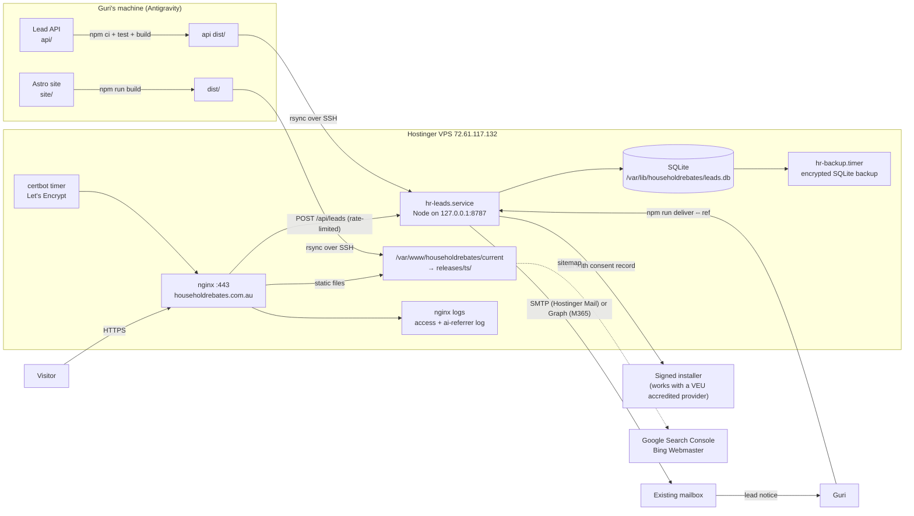

# Household Rebates — solution design

Site: **householdrebates.com.au** · Brand: **Household Rebates** · Publisher: Agenor Services Pty Ltd (ABN: `<<AGENOR_ABN>>`)
Prepared: 13 Nov 2026 (Melbourne time) for Guri, by Indie Builder. Source strategy: Venture Architect's Page, "Energy rebates" tab.
Status: design only. No code written, nothing touched on the VPS, DNS or Hostinger.
Updated 13 Nov 2026 (Melbourne time) for the approved expansion from 16 to 53 URLs. The source of truth is Venture Architect's `url-map.md` / `url-map.csv`, and prompts 15–23 build it. Changed sections: §0, §1 (verified 2027 exemptions, new facts), §4.1a–4.1d (53-URL map, hub, internal links, redirects), §5 (schemas), §6 (checker paths), §10.2–10.4, §13, §14 and §15.

> **Not legal advice.** Everything below on the VEU code of conduct, privacy, spam and consumer law is a builder's reading of the official pages listed in §15. The consent wording, collection notice, privacy policy, terms and installer agreement need a lawyer's check before the form goes live.

---

## 0. The short version

- **What:** a Victoria-first, independent guide to Victorian Energy Upgrades (VEU) discounts for reverse-cycle air conditioning and heat pump hot water, plus the 1 March 2027 gas hot water rule. It makes money by passing consented quote requests to one to three **named** installers who work with a VEU accredited provider, for a lead fee.
- **How:** an Astro static site, built in Antigravity, served by nginx from `/var/www/householdrebates/current` on the existing Hostinger VPS (72.61.117.132). One small Node service on `127.0.0.1:8787` takes form posts, stores them in SQLite and emails them. No paid services.
- **Rules built into the code:** every dollar figure comes from one data file with a source URL and a checked-on date, and a build check fails if a raw `$` amount appears anywhere else. The form only switches on when a signed installer agreement is recorded. Consent is stored with its exact wording and version.
- **Order:** fix the VPS first (certbot is broken), then build locally, then deploy with the form **off**, then switch the form on only after the installer agreement, privacy policy and lawyer check.
- **Expansion (approved 13 Nov 2026):** 16 → 53 URLs in three waves: Wave 1 is 19 money and question pages plus the `/victoria/` hub; Wave 2 is 10 audience pages, tools and support guides; Wave 3 is 8 location pages, with Shepparton gated. Fixes to live pages come first: the 30 Sep 2026 co-payments, the Solar Homes caps and the verified 2027 exemptions. The checker gains insulation, induction and draught-proofing paths. The quote form stays off throughout. Prompts 15–23.

---

## 1. Facts this design relies on (checked 13 Nov 2026)

Every figure on the site has to come from these pages, re-checked at publish time. Indicative only: Energy Victoria says the final discount depends on the certificate price, product, location and provider.

| Fact | Value | Official source | Page last updated |
|---|---|---|---|
| Reverse-cycle AC, household, replacing a **ducted gas heater** with a ducted RCAC (22.4 kW) | up to **$5,530** | [Energy Victoria — Heating and cooling discounts](https://www.energy.vic.gov.au/victorian-energy-upgrades/products/heating-and-cooling-discounts) | 29 Oct 2026 |
| RCAC replacing a **non-ducted (room) gas heater**, 3–9 kW | **$630 to $1,610** | same | 29 Oct 2026 |
| Other household RCAC rows (ducted gas → 10 kW / 16 kW: up to $2,520 / $4,200; central electric resistance ducted: up to $5,460; multi-split replacing ducted gas: up to $2,940; 4 splits replacing ducted gas: up to $2,520; hard-wired electric room heater: up to $840; non-ducted RCAC: $210; no decommissioning: $70–$140 room, up to $410 ducted; ducted RCAC replaced 10/16/22.4 kW: up to $490/$770/$910) | as listed | same | 29 Oct 2026 |
| RCAC eligibility | Approved high-efficiency RCAC that heats and cools; min 5-year warranty (homes); via an accredited provider or an installer working with one; if replacing a system, property > 2 years old; rentals eligible | same | 29 Oct 2026 |
| Heat pump HW replacing an **inefficient electric** system | **$630** | [Energy Victoria — Hot water system discounts](https://www.energy.vic.gov.au/victorian-energy-upgrades/products/hot-water-system-discounts) | 26 Oct 2026 |
| Heat pump HW replacing an **inefficient gas** heater | **$560** | same | 26 Oct 2026 |
| Solar-boosted replacing electric / gas | $910 / $700 | same | 26 Oct 2026 |
| Combined with Solar Homes hot water rebate | up to $1,560; up to $1,960 with an eligible locally made product (+$400) | same | 26 Oct 2026 |
| Hot water eligibility | Existing system being replaced, in a building at least 2 years old; approved product with min 5-year warranty; households up to 2 systems; minimum customer contribution $200 | same | 26 Oct 2026 |
| No retrospective discounts (generally) | "We strongly recommend contacting an accredited provider before purchasing or installing … Retrospective discounts are typically not possible." Own installer must work with an accredited provider "before any work starts". | both product pages; [About VEU](https://www.energy.vic.gov.au/victorian-energy-upgrades/about) | — |
| Gas hot water rule, existing homes | From **1 March 2027**, a gas water heater (incl. gas pool heater) needing replacement in an existing home can't be replaced with another mains gas water heater; must be electric. Owner-occupiers: no requirement to change gas space heating or cooking. Exemptions exist. | [Energy Victoria — electrification standards](https://www.energy.vic.gov.au/households/save-with-all-electric-home/electric-and-efficiency-standards-for-buildings); hot water page above | 9 Oct 2026 |
| Rental homes from 1 March 2027 | A broken, unrepairable water heater → efficient electric (heat pump or electric-boosted solar); broken heater → efficient RCAC in main living area; efficient cooling in main living area at start of a new lease | electrification standards page; heating and cooling page | 9 Oct / 29 Oct 2026 |
| LPG not affected | "…as well as the use of LPG, are not affected." | [Vic Planning — Gas Substitution Roadmap](https://www.planning.vic.gov.au/guides-and-resources/strategies-and-initiatives/victorias-gas-substitution-roadmap) | not shown |
| VEU code of conduct covers lead generation and marketing | "Regulated actions" include lead generation and marketing; applies to accredited persons and scheme participants | [ESC — VEU code of conduct](https://www.esc.vic.gov.au/victorian-energy-upgrades/participating-veu-program/meeting-your-obligations-under-veu-code-conduct) | — |
| Cold-call bans | Telemarketing ban from 1 May 2024, doorknocking from 1 Aug 2024, unless express prior consent | same; [ESC FAQ on the bans v1.1 (PDF)](https://www.esc.vic.gov.au/sites/default/files/documents/VEU%20Telemarketing%20and%20doorknocking%20bans%20-%20Frequently%20asked%20questions%20-%20v%201.1%20-%2020240801.pdf) | 1 Aug 2024 |
| Express prior consent | Can be given via an online enquiry form; record: identity, who may contact, which activity, phone and/or visit, expiry, withdrawal date; lasts **3 months** unless withdrawn or a longer period agreed; ESC recommends naming the installation partner in the consent form | ESC FAQ Q14–Q20 | 1 Aug 2024 |
| Lead buyers are liable | Buyers "can't rely on the seller's statement"; buying leads is "high-risk" and should get legal advice (FAQ Q10) — this is why installers will ask for our consent records | ESC FAQ Q10 | 1 Aug 2024 |
| Lead-gen do/don't | Clear, accurate info; don't mislead; don't claim to work for VEU, the ESC or the Victorian Government; tell consumers about the code and offer the VEET scheme consumer factsheet; give the name of the accredited person creating certificates; comply with spam laws | [ESC lead generation and marketing fact sheet v1.2 (PDF)](https://www.esc.vic.gov.au/sites/default/files/documents/PBL%20-%20Lead%20generation%20and%20marketing_fact_sheet%20-%20v%201.2%20-%2020240801.pdf) | 1 Aug 2024 |
| Trading in personal information | Disclosing personal info to someone else for a benefit is "trading"; a small business that trades is covered by the APPs **unless** it has the consent of all individuals concerned (or is authorised/required by law) | [OAIC — Trading in personal information](https://www.oaic.gov.au/privacy/privacy-guidance-for-organisations-and-government-agencies/organisations/trading-in-personal-information); [OAIC — Small business](https://www.oaic.gov.au/privacy/privacy-guidance-for-organisations-and-government-agencies/organisations/small-business) | — |
| Spam Act | Consent first (express best); identify sender with contact details; functional unsubscribe honoured within 5 working days; keep a record of who consented, when and how | [ACMA — Avoid sending spam](https://www.acma.gov.au/avoid-sending-spam) | 29 Nov 2024 |
| Lead price benchmark | PumpSwap: first lead free, then **$39 inc GST per accepted lead** (leads 1–11 a month), $33 from the 12th | [PumpSwap for installers](https://pumpswap.com.au/for-installers) | checked 13 Nov 2026 |
| M365 SMTP AUTH (Basic) | Disabled by default for existing tenants at end of Dec 2026 (admin can re-enable); final removal date to be announced H2 2027 | [Microsoft Exchange Team, 27 Jan 2026](https://techcommunity.microsoft.com/blog/exchange/updated-exchange-online-smtp-auth-basic-authentication-deprecation-timeline/4489835) | 29 Jan 2026 |

**Two corrections to the brief, both from the official pages:**

1. "Up to $630 off heat pump hot water" is the **electric → heat pump** figure. **Gas → heat pump is $560**. The 2027 gas rule pages must use $560, not $630.
2. "Up to $5,530" is only the largest **ducted gas → 22.4 kW ducted RCAC** case. A typical single split replacing a room gas heater is $630–$1,610. Pages must say "up to" and show the scenario table, never lead with $5,530 alone.

**2027 gas hot water exemptions: now verified (13 Nov 2026).** Venture Architect read the regulation text: Building and Plumbing Amendment Regulations 2025 (SR 140/2025), reg 6, which inserts reg 45E into the Plumbing Regulations ([AustLII text](https://classic.austlii.edu.au/au/legis/vic/num_reg/bapar2025n140o2025463/s6.html); authority: [legislation.vic.gov.au](https://www.legislation.vic.gov.au/as-made/statutory-rules/building-and-plumbing-amendment-regulations-2025)). The earlier "not verified" note is replaced. The exemptions, in plain words:

- **Practical limits (45E(3)):**
  - not enough space inside, or no suitable outdoor space, for an electric water heater
  - a Class 2 building (apartments) or a pool served by a centralised gas system
  - an electric option would be unlawful under another law
  - it would need the main switchboard or a distribution board altered
  - it would need the electricity network augmented beyond a basic or standard connection
- **Kinds of work (45E(4)):**
  - temporary disconnection and reconnection
  - like-for-like replacement where the gas water heater doesn't need an electricity connection to run
  - replacement within the warranty period
- **Timing (45E(5)):**
  - work under a contract signed before 1 March 2027, if done within 3 months after that date
  - building work under s10(1) or (2) of the Building Act before 1 March 2027
  - rectification orders issued before 1 March 2027
- **Penalty:** 20 penalty units for the plumber.
- The Gazette notice (GG2025S654) confirms the switchboard, no-electricity and warranty items.

On the site this is a plain-English summary, not legal advice, and "your licensed plumber decides". Guri reads it against the AustLII text before it's published (prompts 15 and 18). The date wording "exempt work must be done by 1 June 2027" is **not** verified. Write "within 3 months after 1 March 2027".

Search volumes (1,620 / 1,300 / 320 a month, KD 4–8) are Super SEO's figures (26 Sep 2026), carried from the strategy and not re-checked. The URL map used no volume data: its "intent" column is qualitative.

### 1.1 Facts added for the 53-URL expansion (from `url-map.md`, checked 13 Nov 2026)

Full per-page facts and URLs are in `url-map.csv`, and the source index is in `url-map.md`. These are the ones that change the design:

| Fact | Value | Source |
|---|---|---|
| **VEU minimum co-payments from 30 Sep 2026** (per installed product, incl. GST) | All ducted (any size) **$3,000** (was $1,000); multi-split ≥ 10 kW $3,000; multi-split < 10 kW $1,000; other non-ducted ≥ 10 kW $1,000; other non-ducted < 10 kW $200; hot water (activities 1, 3) $200; ceiling insulation (48) $200; induction $200 per product; larger commercial $10,000 | [VEU Specifications v25.0, Part 6 (PDF)](https://www.energy.vic.gov.au/__data/assets/pdf_file/0041/795488/Victorian-Energy-Upgrades-Specifications-2018-Version-25.pdf), p. 29; [industry specifications page](https://www.energy.vic.gov.au/victorian-energy-upgrades/installers/industry-specifications). Energy Victoria's consumer page doesn't show it yet. |
| Multi-split | All indoor units from the same manufacturer as the outdoor unit; v25.0 revised the multi-split calculations from 30 Sep 2026 | SPEC25 |
| Ceiling insulation (new VEU product) | Up to $1,500 metro (mild) / $2,100 regional (cold), 150 m² example; cuts install cost by about 30–50%; saves more than $400 a year; almost 60% of homes have none or too little; eligible below R2.0 (about 90 mm); electrical safety assessment first; halogen downlights make a home ineligible until fixed; EEC-certified installers | [Energy Victoria insulation](https://www.energy.vic.gov.au/victorian-energy-upgrades/products/insulation-discounts); [Solar Victoria news](https://www.solar.vic.gov.au/victorians-cut-energy-bills-ceiling-insulation-discounts) |
| Induction cooktops | $140 per product (based on a $70 certificate price); buy, then send the invoice to an accredited provider; must replace a gas cooktop; home ≥ 2 years old; not claimed before; no portable units; ≥ 550 × 380 mm, 3+ zones, 2-year warranty; removing all gas avoids about $350–$400 a year in supply charges | [Energy Victoria induction](https://www.energy.vic.gov.au/victorian-energy-upgrades/products/induction-cooktop-discounts) |
| Weather sealing / glazing | Examples: apartment $70/$140, townhouse $280/$560, house $350/$700 (2-/5-year warranty). Homes with open-flued or flueless gas heaters, or open-flued water heaters indoors, don't qualify (CO risk). Glazing $210 double / $140 secondary per 10 m² | [weather sealing](https://www.energy.vic.gov.au/victorian-energy-upgrades/products/weather-sealing-discounts), [glazing](https://www.energy.vic.gov.au/victorian-energy-upgrades/products/window-glazing-discounts) |
| Solar Homes hot water | Up to $1,000 ($1,400 locally made), 50% of price, calculated after STCs and VEECs; owner-occupier; household income **< $150,000 from 1 Jul 2026** (was $210,000); property < $3m; system ≥ 3 years old; pre-approval, then install within 120 days | [hot water rebate](https://www.solar.vic.gov.au/hot-water-rebate); [income cap news](https://www.solar.vic.gov.au/solar-homes-program-continuing-provide-targeted-assistance) |
| Solar PV | Up to $1,400 plus a loan to 30 Jun 2027; moves into VEU from 1 Jul 2027 (affects the reserved `/solar-battery/` section) | [PV rebate](https://www.solar.vic.gov.au/solar-panel-rebate); [transition](https://www.solar.vic.gov.au/solar-support-continue-through-victorian-energy-upgrades-program) |
| LPG hot water | VEU Part 3 covers "gas or LPG" water heaters, but Energy Victoria's table has only a gas figure. The LPG amount is **UNVERIFIED**, so the site says "provider confirms" | SPEC25 |
| VEU postcode table | SPEC25 Table A, "Location Variable List": Metropolitan/Regional, reticulated gas, climatic region Mild/Cold/Hot, heat pump zone 4/5. **719 rows** (`pdftotext -raw`; `-layout` drops 19) | SPEC25 |
| Stale official summaries: don't use | The 'Latest discounts and rebates' page (24 Jul 2026) says ducted saving "up to $1,410" and PV "up to $2,800"; the Solstice page also says PV $2,800. Product pages win: $1,140 and $1,400 | [stale page](https://www.energy.vic.gov.au/households/latest-discounts-and-rebates), deny-listed in `check-sources` |
| Source URL moved | The electrification standards page is now under `/households/save-with-all-electric-home/…` (updated in §1 and §15) | [Energy Victoria](https://www.energy.vic.gov.au/households/save-with-all-electric-home/electric-and-efficiency-standards-for-buildings) |
| Policy risk | Victorian state election on 28 Nov 2026. DEECA's work program has pending water heating and space heating review responses and a hydronic activity. The VEET Act was amended (Act 37/2026): on proclamation, VEECs become "energy upgrade certificates" | [work program](https://www.energy.vic.gov.au/victorian-energy-upgrades/installers/industry-market-update-work-program); [ESC legislation](https://www.esc.vic.gov.au/victorian-energy-upgrades-program/about-victorian-energy-upgrades-program/veu-program-legislation) |
| Competitor | Easy Electric SEC (state-owned SEC, launched 25 May 2026): a free quote-matching service with endorsed installers. Councils route residents to it | [SEC](https://www.secvictoria.com.au/news/going-electric-at-home-is-now-easy-as-with-sec) |

**Still UNVERIFIED (kept off every page; tracked in `docs/expansion-log.md`):**

- the multi-split "at most 20 kW" calculation (SPEC25 v25.0 Part 6 appears to have a 20 kW residential input line; the map still marks it unverified)
- the combined electric → heat pump "$1,630 / $2,030"
- "one hard-wired heater per home"
- repeat-claim limits for heating and cooling
- the LPG hot water amount
- the VEEC rename commencement date
- live VEEC prices
- default tariffs
- the gas meter abolishment fee
- the Power Saving Bonus
- the Solar for Apartments lot limit (3–50 vs 150)
- the "by 1 June 2027" wording
- the Wyndham survey
- the Whittlesea "Energy Smart Homes Grant"
- Shepparton's Solar Savers program

---

## 2. Architecture



**Decisions and reasons**

| Area | Decision | Why |
|---|---|---|
| Site | Astro (v6 is current; uses the content layer API), `output: 'static'`, `trailingSlash: 'always'`, `build.format: 'directory'` | Same pattern as netpayworldwide.com. Fast static HTML, typed content collections, no server needed for pages. |
| Interactivity | Two islands only: eligibility checker and lead form, both vanilla TypeScript (no React) | Smallest JS. The form also works as a plain HTML post without JS. |
| Form handler | **Node** (Node 24 LTS, or 22 LTS if that's what the VPS already runs), Fastify + better-sqlite3 + nodemailer | See §7.1. |
| Storage | SQLite file, WAL mode | One writer, tiny volume, no DB server, easy backup. |
| Email | One transport interface, two drivers: `smtp` (Hostinger Mail) and `graph` (M365 OAuth) | Microsoft switches Basic SMTP AUTH off by default at the end of Dec 2026, so an M365 mailbox must use Graph. |
| Hosting | Same VPS, own nginx server block, own system user, own data dir | Isolation from the other six sites. No new spend. |
| Analytics | GSC + Bing + GoAccess over nginx logs + AI-referrer log + form "how did you hear" + SQLite counts | Free, no cookies, no banner, nothing third-party in the page. |

---

## 3. Repo and folder structure

One private Git repo (suggest `github.com/microforgeai/householdrebates` — open decision), npm workspaces for the site and the API.

```
householdrebates/
├─ README.md
├─ package.json                 # workspaces: ["site", "api"]; root scripts call each
├─ .nvmrc                       # 24 (or 22 to match the VPS)
├─ .editorconfig  .gitignore  .gitattributes
├─ .github/workflows/ci.yml     # check + test + build on every push (no deploy from CI)
├─ ops/
│  ├─ nginx/householdrebates-http.conf      # → /etc/nginx/conf.d/ (map, log_format, limit_req_zone: http context)
│  ├─ nginx/householdrebates-headers.conf   # → /etc/nginx/snippets/ (security headers)
│  ├─ nginx/householdrebates-prelaunch.conf # → /etc/nginx/snippets/ (basic auth + noindex until launch)
│  ├─ nginx/householdrebates.com.au.http-only.conf  # port 80 only, to obtain the certificate
│  ├─ nginx/householdrebates.com.au.conf    # → /etc/nginx/sites-available/ (server blocks)
│  ├─ systemd/hr-leads.service
│  ├─ systemd/hr-backup.service  systemd/hr-backup.timer
│  ├─ logrotate/householdrebates
│  ├─ deploy-site.sh            # build → rsync → atomic symlink swap
│  ├─ deploy-api.sh
│  ├─ rollback.sh               # site|api → previous release
│  ├─ backup.sh                 # sqlite3 .backup + age-encrypt + prune
│  └─ ai-report.sh              # weekly summary of the AI-referrer log
├─ site/
│  ├─ astro.config.mjs
│  ├─ tsconfig.json
│  ├─ public/
│  │  ├─ robots.txt
│  │  ├─ favicon.svg  apple-touch-icon.png  og-default.png
│  │  └─ .well-known/security.txt
│  ├─ scripts/
│  │  ├─ check-figures.mjs      # fails on raw $ amounts outside <Money>/figures; fails on stale figures
│  │  ├─ check-answers.mjs      # every indexable page has a 2–4 sentence answer block
│  │  ├─ check-copy.mjs         # banned phrases (§12)
│  │  ├─ check-consent-hash.mjs # site consent text == API consent text
│  │  ├─ check-installers.mjs   # site installers == api/installers.json
│  │  ├─ check-sources.mjs      # every source URL returns 200 (manual, not CI)
│  │  └─ build-llms.mjs         # writes dist/llms.txt from collections
│  ├─ src/
│  │  ├─ content.config.ts      # collections + zod schemas (§5)
│  │  ├─ content/
│  │  │  ├─ guides/vic/*.mdx    # air-conditioner-rebate, heat-pump-rebate, reverse-cycle-vs-gas-heater, gas-to-electric-hot-water-2027
│  │  │  ├─ areas/vic/*.mdx     # melbourne, geelong, frankston, mornington-peninsula
│  │  │  ├─ pages/*.mdx         # home, eligibility-checker, how-quotes-work, faq, about, privacy, sources, terms
│  │  │  ├─ faqs/*.yaml
│  │  │  ├─ figures/vic-veu.yaml
│  │  │  ├─ sources/*.yaml
│  │  │  ├─ installers/         # empty until an agreement is signed
│  │  │  └─ solar-battery/      # reserved, empty (§5.6)
│  │  ├─ data/
│  │  │  ├─ site.ts             # name, domain, publisher, ABN, contact, enabled states, flags
│  │  │  ├─ states.ts           # vic enabled; others defined, disabled
│  │  │  ├─ consent/vic-v1.ts   # consent + collection-notice wording, versioned
│  │  │  └─ eligibility/vic-rules.ts
│  │  ├─ layouts/  BaseLayout.astro  GuideLayout.astro  AreaLayout.astro  ToolLayout.astro  LegalLayout.astro
│  │  ├─ components/
│  │  │  ├─ seo/Seo.astro  seo/JsonLd.astro  seo/Breadcrumbs.astro
│  │  │  ├─ AnswerBlock.astro  Money.astro  FigureTable.astro  CheckedOn.astro
│  │  │  ├─ SourceList.astro  SourceLink.astro  IndependenceNotice.astro
│  │  │  ├─ Callout.astro  Steps.astro  Faq.astro  RelatedLinks.astro  Toc.astro
│  │  │  ├─ LeadForm.astro  lead-form.client.ts  FormClosedNotice.astro
│  │  │  ├─ EligibilityChecker.astro  eligibility.client.ts
│  │  │  └─ Header.astro  Footer.astro
│  │  ├─ lib/  figures.ts  sources.ts  schema.ts  urls.ts  dates.ts  eligibility.ts  routing.ts
│  │  ├─ pages/
│  │  │  ├─ index.astro
│  │  │  ├─ victoria/[slug].astro       # guides, areas and the checker under /victoria/
│  │  │  ├─ [page].astro                # how-quotes-work, faq, about, privacy, sources, terms
│  │  │  ├─ thanks.astro  form-error.astro  404.astro   # noindex
│  │  │  └─ solar-battery/index.astro   # excluded from build while SOLAR_SECTION_ENABLED=false
│  │  └─ styles/tokens.css  base.css  prose.css
│  └─ tests/  unit/*.test.ts (vitest)  e2e/*.spec.ts (Playwright)
└─ api/
   ├─ package.json  tsconfig.json
   ├─ src/
   │  ├─ server.ts           # Fastify app, routes, startup guard
   │  ├─ config.ts           # env parsing; fails closed
   │  ├─ schema.ts           # request validation
   │  ├─ db.ts  migrations/001_init.sql
   │  ├─ consent.ts          # imports the same wording file as the site (hash-checked)
   │  ├─ routing.ts          # postcode + activity → named installers
   │  ├─ antispam.ts         # honeypot, signed form token, per-IP-hash limits
   │  ├─ mail/index.ts  mail/smtp.ts  mail/graph.ts  mail/templates.ts
   │  └─ cli/  deliver.ts  withdraw.ts  export.ts  erase.ts  purge.ts  status.ts  mail-test.ts
   ├─ installers.json        # signed installers only; [] at launch
   └─ test/                  # vitest + fastify.inject
```

**Added by the expansion (prompts 15–23):**

- `docs/url-map.md`, `docs/url-map.csv` and `docs/expansion-log.md` (conflicts, UNVERIFIED items, decisions); `docs/recheck/<date>.md`
- `site/scripts/`: `import-url-map.mjs`, `check-urlmap.mjs`, `extract-veu-postcodes.mjs` (run by hand), `build-redirects.mjs` and `recheck-report.mjs`
- `site/src/data/`: `url-map.json`, `rollout.json`, `redirects.json`, `stale-sources.json`, `vic-veu-postcodes.json` and `tools/hw-size-guide.json`; `eligibility/result-links.ts`
- `site/src/pages/victoria/index.astro` (hub)
- Components: `Breadcrumbs`, `RelatedLinks`, `HubIndex`, plus the `RunningCostsPicker`, `HwSizeGuide` and `GasExitPlanner` islands
- `ops/nginx/householdrebates-redirects.conf` (generated; not included in nginx until a redirect is needed and Guri approves)

---

## 4. URLs, page templates and components

### 4.1 Launch URL map (15 URLs = the strategy's "first 12 pages")

| # | URL | Template | Primary query / purpose | Form |
|---|---|---|---|---|
| 1 | `/` | Home pillar | rebate cluster (~1,620/mo) | yes |
| 2 | `/victoria/air-conditioner-rebate/` | Guide | air conditioner rebate victoria (1,300/mo, KD 4) | yes |
| 3 | `/victoria/heat-pump-rebate/` | Guide | heat pump rebate victoria (320/mo, KD 8) | yes |
| 4 | `/victoria/reverse-cycle-vs-gas-heater/` | Guide | the "provider before work starts" rule; decommissioning; renters from 2027 | link to checker |
| 5 | `/victoria/eligibility-checker/` | Tool | people who want the discount, not the scheme name | after a result |
| 6 | `/victoria/gas-to-electric-hot-water-2027/` | Guide | 1 March 2027 rule; heat pump intent | yes |
| 7–10 | `/victoria/melbourne/`, `/victoria/geelong/`, `/victoria/frankston/`, `/victoria/mornington-peninsula/` | Area | suburb demand Super SEO measured (e.g. Geelong 390, Mornington 170) | only where a signed installer covers it |
| 11 | `/how-quotes-work/` | Guide + HowTo | trust and conversion; consumer rights under the VEU code | link |
| 12 | `/faq/` | FAQ | common questions | link |
| 13 | `/about/` | Trust | who runs it, ABN, how we're paid, editorial method | no |
| 14 | `/privacy/` | Legal | APP privacy policy + collection notice | no |
| 15 | `/sources/` | Trust | every source with checked-on dates; method | no |
| + | `/terms/` (recommended), `/thanks/`, `/form-error/`, `/404.html` | Legal / utility | utilities are `noindex` | — |

URL rules: state folder for anything state-specific (`/victoria/…`, later `/nsw/…`); state-neutral pages at root. **No mass suburb pages**: an area page only exists when it has at least four sourced, genuinely local facts (§5.4). The launch set above is now Wave 0 of the 53-URL map (§4.1a).

### 4.1a Expanded URL map: 53 URLs (approved 13 Nov 2026)

The source of truth is `url-map.csv` (one row per URL: question, facts with sources, required internal links, CTA, notes), imported at build time into `site/src/data/url-map.json` (prompt 15). Counts, cross-checked against the CSV:

| Wave | URLs | What | Prompt |
|---|---|---|---|
| 0 (live) | 16 | The launch set above, including `/terms/` | 01–14; fixes in 15–16 |
| 1 | 19 | `/victoria/` hub; 9 upgrade swap guides (rows 18–26); 9 question pages (rows 27–35) | 17 (hub + 9), 18 (9) |
| 2 | 10 | 5 audience pages (36–40), 3 tools (41–43), 2 support guides (44–45) | 19 (7), 20 (3) |
| 3 | 8 | Ballarat, Bendigo, Wyndham, Casey, Whittlesea, Yarra Ranges, Solstice gas-shutdown towns (multi-town); **Shepparton gated** | 21 (7), 22 (Shepparton) |
| **Total** | **53** | Noindex utilities (`/thanks/`, `/form-error/`, `/404.html`) not counted | |

```
/  about/  faq/  how-quotes-work/  privacy/  sources/  terms/
victoria/                                   hub (W1), the breadcrumb "Victoria" item
├─ eligibility-checker/                     tool (live; new paths in prompt 16)
├─ Rebate guides (live): air-conditioner-rebate/ heat-pump-rebate/ reverse-cycle-vs-gas-heater/ gas-to-electric-hot-water-2027/
├─ Upgrade guides (W1): ducted-gas-to-ducted-reverse-cycle/ ducted-gas-to-split-systems/ gas-room-heater-to-split-system/
│    electric-heater-to-reverse-cycle/ gas-hot-water-to-heat-pump/ electric-hot-water-to-heat-pump/ solar-hot-water-rebate/
│    gas-cooktop-to-induction/ ceiling-insulation-rebate/
├─ Question pages (W1): what-is-a-veec/ veu-minimum-co-payment/ can-you-claim-veu-twice/ veu-vs-solar-homes/ veu-scams-cold-calls/
│    gas-hot-water-broken-before-or-after-march-2027/ gas-hot-water-ban-exemptions/ already-installed-retrospective-discount/
│    how-long-does-an-upgrade-take/
├─ Audience (W2): renters/ landlords-rental-standards-2027/ concession-card-holders/ new-homes-all-electric-2027/ apartments-and-units/
├─ Tools (W2): gas-vs-heat-pump-running-costs/ heat-pump-hot-water-size-guide/ get-off-gas-planner/
├─ Support guides (W2): draught-proofing-rebate/ find-an-accredited-provider/
└─ Areas: melbourne/ geelong/ frankston/ mornington-peninsula/ (live) · ballarat/ bendigo/ shepparton/ (gated) wyndham/ casey/
     whittlesea/ yarra-ranges/ solstice-gas-shutdown-towns/ (W3)
```

**Dropped:** Melton. Its VEU postcode data and NCC zone match Melbourne, and it has no local program, so it has fewer than 4 local facts. **Shepparton** passes on 4 facts, but Guri gated it until the council's Goulburn Murray Solar Savers program is verified (the page returned 504 on 13 Nov 2026). Prompt 22 is a hard stop with a verification step.

**Rules the expansion keeps:**

- URLs stay flat (`/victoria/<slug>/`).
- No pages beyond the map: `check-urlmap` fails on any extra indexable URL, which blocks mass suburb pages.
- Every page has its own question, an answer-first opening, `<Money>` figures with checked-on dates, a visible FAQ with `FAQPage`, at least 3 internal links and the `IndependenceNotice`.
- The CTA is always the eligibility checker. The quote form stays off.

### 4.1b The `/victoria/` hub and the home page

- `/victoria/` is rendered by the new `src/pages/victoria/index.astro` from `content/pages/victoria.mdx` (GuideLayout variant `hub`). `HubIndex` lists every enabled `/victoria/` page by `navGroup` (`rebate-guides`, `upgrade-guides`, `question-pages`, `audience`, `tools`, `support-guides`, `areas`), in the tree order above, with the checker first.
- Breadcrumbs are Home › Victoria › Page on every `/victoria/*` page, and `BreadcrumbList` matches.
- **Home:** the map says home "stays the national-facing pillar", but the live home (prompt 05) is Victoria-first in its title, H1 and answer. The expansion only adds a compact hub index (upgrade guides and question pages) to home. Rewriting home as a national pillar is an open decision (§14).

### 4.1c Internal linking

- **Required links:** each row's `internal_links` (`url-map.csv`). `RelatedLinks` renders the row's links whose targets are enabled, with anchor text from the target's H1. At least 2 row links must sit in the body copy (`[data-body]`).
- **Inbound:** every indexable page needs at least 2 inbound links from other pages' `<main>`, and the hub counts as one. Header and footer navigation don't count. The map gives no row links into `/victoria/electric-heater-to-reverse-cycle/`, `/victoria/already-installed-retrospective-discount/` or `/victoria/shepparton/`, so they get links from:
  - the AC rebate page
  - the timing rule page and the checker's RETRO result
  - the AreaLayout "Other areas" list
- **Existing → new:**
  - AC → 4 heating swap guides
  - heat pump → 3 hot water swap guides
  - timing rule ↔ room heater guide
  - gas 2027 → exemptions and the before/after page
  - AC co-payment section → co-payment page
  - Geelong → insulation
- **Checker → guides:** `RESULT_LINKS` (prompt 16) holds an internal page per activity once it exists, and the official page before that.
- **Rollout:** `site/src/data/rollout.json` (`enabledRows`, `gatedApproved`) decides what's built, linked, in the sitemap and in llms.txt. Each prompt widens it: 1–26 → 1–35 → 1–40, 44–45 → 1–45 → 1–47, 49–53 → 1–53.
- **`check-urlmap.mjs`** (post-build) fails if any of these is wrong:
  - built URLs ≠ enabled rows
  - a required link is missing
  - fewer than 2 body links
  - an orphan
  - the sitemap count ≠ the enabled count
  - the llms.txt count ≠ the sitemap count

### 4.1d Redirects

The map needs **no** redirects. The mechanism exists for later renames and for the time-limited Solstice page:

- `site/src/data/redirects.json` (`{ from, to, code: 301|410, reason, addedOn }`).
- A build check: `from` isn't a built URL, and `to` is built.
- `build-redirects.mjs` writes `ops/nginx/householdrebates-redirects.conf` (`location = /from/ { return 301 /to/; }`).
- Including that file in the server block is a server change, with its own STOP and `nginx -t`. Do it only when the first redirect is needed (prompt 23 covers the Solstice archive decision).
- Trailing-slash and host canonicalisation stay as in §10.4.

### 4.2 Page anatomy (guides, areas, tool)

1. `IndependenceNotice` (thin bar, every page): "Independent guide run by Agenor Services Pty Ltd. Not a government website. Installers may pay us for enquiries — how we're paid."
2. Visible breadcrumbs (match BreadcrumbList).
3. One H1.
4. `AnswerBlock`: 2–4 sentences that answer the query outright and stand alone when quoted; where the page has a hero figure, the first sentence names the scenario and `<Money id="..." />` amount together, followed by a labelled `<Money variant="block" label="...">` or `<MoneyPair>` hero (`<figure>` with `<figcaption>` label, visible `kind` tag, amount, and checked-on source link).
5. Byline: "By Gurinder Singh, Agenor · Figures checked on 13 Nov 2026 against Energy Victoria · Updated 13 Nov 2026".
6. TOC for pages over ~800 words.
7. Body: short sections, scenario `FigureTable`s, a `Callout` for "talk to an accredited provider before any work starts".
8. Visible FAQ (if any) → FAQPage schema.
9. `LeadForm`, or `FormClosedNotice` (§7.6), or a link to the checker.
10. `SourceList` with checked-on dates.
11. `RelatedLinks`: pillar, checker, sibling guide.

### 4.3 Components (contracts)

| Component | Props | Rules |
|---|---|---|
| `Money` | `id`, `variant?: 'inline' \| 'block'`, `label?: string` | Renders the qualifier and amount ("up to $5,530", "$630 to $1,610"). Inline adds a superscript link to the source; `variant="block"` requires `label` (concise plain words, no `$`, no digits except `kW`, `m²`, `L` or years) and renders `<figure>` with `<figcaption>` label, visible `kind` tag (`discount` → "Indicative discount (the provider confirms)", `payment` → "Minimum you pay", `threshold` → "A limit, not money you receive", `rate` → "Rate", `saving` → "Estimated yearly saving", `count` → "Count"), amount, estimate note (when `basis: 'estimate'`), and "Checked on {date} · {publisher} ↗". Build fails if the id doesn't exist, `label` is missing/invalid, or `checkedOn` is older than `MAX_FIGURE_AGE_DAYS` (default 45). |
| `MoneyPair` | `ids: [string, string]`, `labels: [string, string]` | Renders two `<Money variant="block">` heroes side by side (stacked vertically under 480 px), e.g. mains gas vs electric storage to heat pump. |
| `FigureTable` | `group` | Table from figures data. Caption: checked-on, source link, "Indicative. The accredited provider confirms the final amount in your quote." |
| `CheckedOn` | `date`, `sourceId` | "13 Nov 2026", Australia/Melbourne. |
| `SourceList` | `ids` | Publisher, title, link, checked-on, page last updated. |
| `AnswerBlock` | slot | `data-answer` attribute; `check-answers.mjs` counts 2–4 sentences in built HTML. |
| `LeadForm` | `activity: 'rcac' \| 'hotwater' \| 'either'`, `areaSlug?` | §7. Shows `FormClosedNotice` when `PUBLIC_LEADS_ENABLED !== 'true'` or no active installer covers the activity. |
| `EligibilityChecker` | `state: 'vic'` | §6. |
| `JsonLd` | `graph` | Only §10.2 types. Unit test: no currency amounts in JSON-LD. |
| `IndependenceNotice` | — | No crests, no Victorian Government palette or typeface, no "official", "approved", "government partner". |

### 4.4 Design system (just enough)

- Warm neutral background, one green-teal accent, charcoal text. Deliberately not the Victorian Government navy-and-white look.
- System font stack (no web fonts, no third-party CSS).
- `tokens.css`: colour, 4-pt spacing scale, radius, focus ring, max line length 70ch.
- WCAG 2.2 AA: contrast ≥ 4.5:1, visible focus, 44 px targets, labels on every input, errors tied with `aria-describedby`, no colour-only meaning, works at 200 % zoom.
- Budget: LCP < 1.5 s on 4G, CLS < 0.05, JS < 15 KB gzipped per page, page weight < 150 KB excluding images. Lighthouse ≥ 95 on all four scores.

---

## 5. Content model

Defined in `site/src/content.config.ts` (Astro 6: `defineCollection`, `reference` from `astro:content`; `glob`, `file` from `astro/loaders`; `z` from `astro/zod`).

### 5.1 Shared enums

```ts
const State = z.enum(['vic', 'nsw', 'qld', 'sa', 'wa', 'tas', 'act', 'nt', 'national']);
const Section = z.enum(['rebates', 'areas', 'tools', 'trust', 'solar-battery']);
const Activity = z.enum(['rcac', 'hotwater', 'insulation', 'induction', 'sealing', 'glazing', 'solar', 'battery']); // solar/battery reserved; lead form uses rcac|hotwater only
const NavGroup = z.enum(['hub', 'rebate-guides', 'upgrade-guides', 'question-pages', 'audience', 'tools', 'support-guides', 'areas', 'trust']); // expansion (prompt 17)
```

### 5.2 `sources`

```ts
const sources = defineCollection({
  loader: glob({ pattern: '**/*.yaml', base: './src/content/sources' }),
  schema: z.object({
    title: z.string(),
    publisher: z.string(),                    // "Energy Victoria (DEECA)", "Essential Services Commission"
    url: z.string().url(),
    official: z.boolean(),                    // only official sources can back a figure
    state: State,
    checkedOn: z.coerce.date(),               // when we last read it
    pageLastUpdated: z.coerce.date().optional(),
    notes: z.string().optional(),
    mapKey: z.string().optional(),            // key in url-map.md's source index, e.g. SPEC25 (prompt 15)
    kind: z.enum(['legislation', 'regulator', 'department', 'council', 'council-program', 'state-owned', 'network-business', 'national-agency']).optional(),
    attribution: z.string().optional(),       // e.g. ABCB climate zones, CC BY 4.0
  }),
});
```

Expansion: 65 sources after prompt 15 (13 + 52 from the map's source index; not EVLATEST (stale, deny-listed), MELTON (dropped) or SHEPP (prompt 22 only, after verification)). `check-sources` fetches one URL at a time with a 3 s gap (energy.vic.gov.au is behind Cloudflare), reports Cloudflare challenge pages as `CHALLENGE` for a hand check, and fails on any deny-listed URL.

### 5.3 `figures`

```yaml
# src/content/figures/vic-veu.yaml  (loaded with file())
- id: vic-veu-rcac-ducted-gas-22kw
  group: vic-veu-rcac-ducted-household
  state: vic
  program: VEU
  activity: rcac
  audience: household
  scenario: "Replace a ducted gas heater with a 22.4 kW ducted reverse-cycle system"
  qualifier: up-to            # up-to | range | exact | about
  amountMax: 5530
  currency: AUD
  sourceId: energyvic-heating-cooling
  checkedOn: 2026-11-13
- id: vic-veu-hw-gas-to-heatpump
  group: vic-veu-hotwater-household
  state: vic
  program: VEU
  activity: hotwater
  audience: household
  scenario: "Replace an inefficient gas hot water heater with a heat pump"
  qualifier: exact
  amountMax: 560
  currency: AUD
  sourceId: energyvic-hot-water
  checkedOn: 2026-11-13
```

Schema: `id`, `group`, `state`, `program`, `activity`, `audience: 'household' | 'business'`, `scenario`, `qualifier: 'up-to' | 'range' | 'exact' | 'about' | 'about-range' | 'minimum' | 'more-than' | 'almost'`, `unit: 'AUD' | 'percent' | 'count'` (default AUD), `display: 'standard' | 'cents' | 'compact'`, `basis: 'official' | 'estimate'` (default `official`), `kind: 'discount' | 'payment' | 'threshold' | 'rate' | 'saving' | 'count'` (required, prompt 25), `method?` + `basedOn?` (required when `basis === 'estimate'`), `gstIncluded?`, `effectiveFrom?`, `effectiveTo?` + `supersededBy?` (historical figures may only appear next to their replacement), `amountMin?`, `amountMax`, `currency: 'AUD'` (money only), `sourceId: reference('sources')` (must resolve to `official: true`), `checkedOn`, `conditions?: string[]`. Refinements: `amountMin <= amountMax`; `qualifier === 'range'` requires `amountMin`; `checkedOn <= today`; `basis === 'estimate'` requires `method`, `basedOn` and `kind === 'discount'`.

Rendering: `minimum` → "at least $3,000 (including GST)", `more-than` → "more than $400", `almost` → "almost 60%", `about-range` → "about $350 to $400", `cents` → "$171.60", `compact` → "$3 million". Percentages and volatile counts (provider counts, rebate counts) are figures too, so they share the 45-day freshness rule. Scenario strings never contain a `$` amount. Business figures are allowed only on `/victoria/veu-minimum-co-payment/`.

Launch set (all from §1): 6 household room-RCAC rows, 8 ducted-RCAC rows (gas 10 / 16 / 22.4 kW; central electric; RCAC-replaced 10 / 16 / 22.4 kW; no decommissioning), 4 hot water rows, the 2 combined Solar Homes figures and the $200 minimum contribution (21, prompt 03), plus 3 running-cost figures from Energy Victoria added in prompt 05 (room gas → RCAC saves up to $460 a year; ducted up to $1,140; gas → electric hot water around $400). No business rows at launch.

Expansion figure counts (cumulative, each prompt's `check-figures` expects them):

| After prompt | Added | Total |
|---|---|---|
| 15 | 8 co-payments, 2 insulation, 6 Solar Homes | 40 |
| 16 | induction ×2, weather-sealing examples ×6 | 48 |
| 17 | supply-charge saving, insulation ×3, heat pump electricity reduction | 53 |
| 18 | business co-payment, PV rebate, extra HW rebates count, plumbing certificate threshold | 57 |
| 19 | concessions ×4, new-home savings ×2, Solar for Apartments ×2, glazing ×2, Casey council rebate | 68 |
| 20 | existing-home all-electric savings ×2 | 70 |
| 21 | provider counts ×4, Solstice top-up, Whittlesea assessment value (only if Guri accepts that source as official) | 75–76 |
| 22 | Hume provider counts ×2 (+ a council amount only if the verified page states one) | 77–79 |

Other data files under the same freshness rule: `src/data/vic-veu-postcodes.json` (SPEC25 Table A, 719 rows, prompt 16) and `src/data/tools/hw-size-guide.json` (prompt 20).

### 5.4 `guides`, `areas`, `pages`

```ts
const pageBase = z.object({
  title: z.string().max(60),                   // bare title (no "Household Rebates"); SeoHead appends " | Household Rebates" when <= 60 chars
  h1: z.string().max(90).optional(),           // optional H1 override when frontmatter title is shortened for SERP width (prompt 26)
  description: z.string().min(70).max(155),    // unique across the site, 70–155 chars (prompt 26)
  state: State,
  section: Section,
  slug: z.string().regex(/^[a-z0-9-]+$/),
  answer: z.string(),                          // 2–4 sentences, checked at build
  author: z.literal('Gurinder Singh'),
  publishedOn: z.coerce.date(),
  updatedOn: z.coerce.date(),
  checkedOn: z.coerce.date(),                  // last full fact-check of the page
  sources: z.array(reference('sources')).min(1),
  figures: z.array(z.string()).default([]),    // ids used; must match <Money>/<FigureTable> in the body
  faq: z.array(reference('faqs')).default([]), // rendered visibly → FAQPage
  howTo: z.object({
    name: z.string(),
    steps: z.array(z.object({ name: z.string(), text: z.string() })).min(3),
  }).optional(),
  leadForm: z.union([z.literal(false), z.enum(['rcac', 'hotwater', 'either'])]).default(false),
  noindex: z.boolean().default(false),
  related: z.array(z.string()).default([]),
  legalReviewed: z.boolean().default(false),   // legal pages must be true before LEADS_ENABLED
  navGroup: NavGroup,                          // hub grouping (prompt 17)
  mapRow: z.number().int(),                    // row in url-map.json; must match the page URL
  reviewBy: z.coerce.date().optional(),        // time-sensitive pages, listed in the monthly re-check
});

const areaExtra = z.object({
  areaName: z.string(),
  councils: z.array(z.string()).min(1),
  postcodes: z.array(z.string().regex(/^3\d{3}$/)).min(1),
  localFacts: z.array(z.object({ text: z.string(), sourceId: reference('sources') })).min(4), // anti-doorway
  searchDemand: z.object({ monthly: z.number(), source: z.string(), date: z.coerce.date() }).optional(),
  variant: z.enum(['standard', 'multi-town']).default('standard'),   // expansion (prompt 21)
  towns: z.array(z.string()).min(2).optional(),                       // multi-town only; councils optional there
  veuPostcodeTable: z.boolean().default(true),                        // render SPEC25 Table A rows for `postcodes`
  nccZone: z.object({ zone: z.number(), places: z.array(z.string()) }).optional(), // ABCB attribution rendered
});
```

Area content must be local and sourced: council name(s) and any council energy or electrification program (link to the council page), housing age or heating mix if published (ABS/council), climate note from BoM, gas distributor if confirmed on an official page, which signed installers cover the postcodes. If four sourced local facts can't be found, the page isn't built.

### 5.5 `faqs`, `installers`

```ts
const faqs = z.object({
  question: z.string(),
  answer: z.string(),          // restricted Markdown: plain text + [anchor](/path/) internal links only (no HTML, no images, no $ amounts); rendered as sanitised HTML visibly and plain anchor text in FAQPage JSON-LD (prompt 26)
  pages: z.array(z.string()),  // slugs where it's shown
  state: State,
  checkedOn: z.coerce.date(),
});

const installers = z.object({
  id: z.string(),
  tradingName: z.string(),
  legalName: z.string(),
  abn: z.string().regex(/^\d{11}$/),
  accreditedProvider: z.string(),   // the VEU accredited person who creates certificates
  isAccreditedProvider: z.boolean(),
  activities: z.array(Activity),
  postcodes: z.array(z.string().regex(/^3\d{3}$/)),
  licence: z.object({ type: z.string(), number: z.string() }),
  agreementSignedOn: z.coerce.date(),   // no agreement → no file
  agreementVersion: z.string(),
  contactEmailForLeads: z.string().email(),
  publicBlurb: z.string().max(280),
  active: z.boolean(),
});
```

`installers/` is empty until an agreement is signed. The API reads `api/installers.json`; `check-installers.mjs` fails the build if the two differ.

### 5.6 Room for other states and the solar/battery section

- `state` is on every entry. `src/data/states.ts` lists enabled states. Adding NSW = NSW `sources`, `figures/nsw-*.yaml`, `guides/nsw/*`, enable `nsw` → `/nsw/…` routes, sitemap and llms.txt entries appear. Home stays Victoria-first until another state has content.
- `/solar-battery/` is reserved: `section: 'solar-battery'`, `activity: 'solar' | 'battery'` exist in the enums, and `figures` supports national programs (`state: 'national'`, `program: 'Cheaper Home Batteries'`). The calculator will be a static island like the checker. `SOLAR_SECTION_ENABLED=false` keeps it out of the build, sitemap and llms.txt. It needs its own short design note before work (ACCC rebate-claim guidance, Solar Accreditation Australia wording, STC factors that change each year).

---

## 6. Eligibility checker (static JS)

Pure function `assess(answers, rules, figures)` in `site/src/lib/eligibility.ts`, unit-tested; the UI is a small form island. Nothing leaves the browser unless the person then uses the quote form (answers pre-fill it from `sessionStorage`; no cookies).

### 6.1 Questions

| # | Question | Options |
|---|---|---|
| Q1 | Where is the property? | Victoria / Another state |
| Q2 | What do you want to look at? (choose one or more; was a single choice before prompt 16) | Heating and cooling / Hot water / Ceiling insulation / Induction cooktop / Draught proofing |
| Q3 | Have you already bought or installed the new system, or has work started? | No / Bought, not installed / Installed or work started |
| Q4 | Home or business? | Home / Business |
| Q5 | Do you own or rent? | Own and live there / Rent / Landlord |
| Q6 | Is the building more than 2 years old? | Yes / No / Not sure |
| Q7a (H&C) | What heats the home now? | Ducted gas / Room gas heater / Central electric ducted / Hard-wired electric room heater / Ducted reverse-cycle / Split reverse-cycle / Nothing or other |
| Q7b (H&C) | What would you like? | Ducted reverse-cycle / Split system(s) / Not sure |
| Q8a (HW) | Current hot water system? | Mains gas (storage or instant) / LPG / Electric storage / Solar that no longer works / None |
| Q8b (HW) | Hot water systems already upgraded through VEU at this address? | 0 / 1 / 2 or more / Not sure |
| Q9a (insulation) | Property postcode | 4 digits → VEU postcode table (SPEC25 Table A) |
| Q9b (insulation) | What's in the ceiling now? | None / Thin (less than about 90 mm, or below the top of the joists) / Thicker / Not sure |
| Q9c (insulation) | Halogen downlights, or wiring known to be unsafe? | Yes / No / Not sure |
| Q10a (induction) | Current cooktop? | Gas / Electric (not induction) / Induction already / None |
| Q10b (induction) | Induction discount already claimed at this address? | No / Yes / Not sure |
| Q10c (induction) | Kind of cooktop wanted? | Built-in or freestanding, ≥ 550 × 380 mm, 3+ zones / Portable / Not sure |
| Q11a (sealing) | Kind of home? | Apartment / Townhouse / House |
| Q11b (sealing) | Open-flued or flueless gas heater, or open-flued gas water heater, inside? | Yes / No / Not sure |

Questions are asked only for the activities chosen. A rule the map doesn't state isn't asked or applied: no building-age rule for insulation or weather sealing, and no co-payment for weather sealing.

### 6.2 Rules (from the official pages in §1)

```
Q1 != Victoria          → OUT_OF_AREA. "We only cover Victoria for now." Link to energy.gov.au rebates finder. No form.
Q4 == Business          → BUSINESS. "Business discounts exist but differ; this site covers homes." Link to Energy Victoria. No form.
Q3 == installed/started → RETRO. "Discounts generally need an accredited provider involved before work starts. Retrospective
                          discounts are typically not possible." Link to Energy Victoria. No form.
Q3 == bought, not installed → CAUTION banner (retrospective caveat); form allowed; lead flagged product_bought=true.

Heating and cooling:
  Q6 == No and Q7a not "Nothing/other" → LIKELY_NOT (replacing a system needs a property > 2 years old).
                                          Show the "no decommissioned product" rows as the only possible path.
  (Q7a, Q7b) → figure rows:
     Ducted gas + ducted        → vic-veu-rcac-ducted-gas-10kw / -16kw / -22kw (show all three, "size decides")
     Ducted gas + splits        → 4-splits row and multi-split row
     Room gas + split           → vic-veu-rcac-room-gas (range)
     Central electric + ducted  → central electric row
     Hard-wired electric + split→ hard-wired row
     Ducted RCAC + ducted       → RCAC-replaced rows
     Split RCAC + split         → non-ducted RCAC row
     Nothing/other              → no-decommission rows
     Not sure                   → show the household table, provider confirms
  Q5 == Rent     → "Renters can get the discount, but heating and cooling needs the landlord's approval."
  Q5 in Rent/Landlord → rental minimum standards note (from 1 Mar 2027).

Hot water:
  Q8a == None    → LIKELY_NOT (must replace an existing system).
  Q6 == No       → LIKELY_NOT (building at least 2 years old).
  Q8b == 2+      → LIKELY_NOT (households can upgrade up to 2 systems).
  Q8a mains gas  → $560 heat pump row + 1 Mar 2027 rule callout.
  Q8a electric   → $630 heat pump row.
  Q8a broken solar → heat pump and solar-boosted rows; provider confirms which category applies.
  Q8a LPG        → POSSIBLE, no figure rows (the LPG amount is UNVERIFIED); notes lpg-provider-confirms + lpg-not-covered (2027 rule).
  Always         → note the $200 minimum contribution and the Solar Homes combination (link, not promised).

Co-payments (from 30 Sep 2026, SPEC25 Part 6), note copay-hc with figures by path:
  any ducted result                 → vic-veu-copay-ducted (at least $3,000 incl GST)
  ducted gas + splits               → multi-split ≥10 kW and <10 kW rows + single split <10 kW
  room/split results                → single split <10 kW and non-ducted ≥10 kW rows
  Not sure                          → all heating and cooling co-payment rows

Insulation (prompt 16):
  Q9c Yes      → LIKELY_NOT (halogen downlights or unsafe wiring: ineligible until fixed)
  Q9b Thicker  → LIKELY_NOT (only uninsulated or below R2.0, about 90 mm)
  Show both examples (metro up to $1,500 / regional up to $2,100) + $200 co-payment. Highlight one only when the postcode's
  Metropolitan/Regional AND Mild/Cold columns both match that example; otherwise "the provider confirms which applies".
  Unknown postcode → POSSIBLE. Notes: safety checks, EEC-certified installer, few providers listed, renter permission,
  rental R5.0 at a new lease from 1 Mar 2027.

Induction:
  Q10a not Gas → LIKELY_NOT · Q6 No → LIKELY_NOT · Q10b Yes → LIKELY_NOT · Q10c Portable → LIKELY_NOT
  Figures: $140 per product + $200 co-payment. Note: buy first, then send the invoice to an accredited provider.
  Q3 "bought" is normal (no retro caution); Q3 "installed" → POSSIBLE + retro note (decision for Guri).

Draught proofing (weather sealing):
  Q11b Yes → LIKELY_NOT (carbon monoxide risk) · Not sure → POSSIBLE + safety note
  Figures: the two examples for the home type (2-/5-year warranty). Renters: CAV reasonable-change note; rental standard from 1 Jul 2027.

RETRO result links /victoria/already-installed-retrospective-discount/ once built (RESULT_LINKS; Energy Victoria's page before then).
The quote button never shows for insulation, induction or sealing (lead activities stay rcac | hotwater), and is hidden anyway while the form is off.

"Not sure" anywhere → POSSIBLE. "An accredited provider confirms this when they quote."
```

### 6.3 Result wording (fixed patterns, no promises)

- LIKELY: "From what you've told us, this upgrade **looks like it fits** the VEU rules. Energy Victoria lists an indicative discount of {Money} for this situation. The accredited provider confirms whether you're eligible, and the actual amount, in your quote."
- Every result shows the scenario row, a checked-on line, the source link and "Indicative only. The discount depends on the certificate price, product, location and provider."
- Banned in checker output (enforced by `check-copy.mjs` and unit tests): "you will get", "you qualify", "guaranteed", "free", "government rebate approved", "claim now".

---

## 7. Lead form and handler

### 7.1 Node or PHP — recommendation: **Node**

| | Node (Fastify) | PHP (PHP-FPM) |
|---|---|---|
| On the VPS already | Very likely (havenlyescape.com.au runs Next.js); prompt 00 confirms version and path | Unknown; may need php-fpm installed and patched |
| Same language as the site | Yes: TypeScript, shared consent text and validation | No |
| Tests | vitest + `fastify.inject`, runs in CI | phpunit, a second toolchain |
| Process model | Needs a systemd unit (provided) | Per request, no daemon |
| Mail | nodemailer (SMTP), fetch (Graph) | PHPMailer |

Node wins on one toolchain, shared types and testability. Cost: one systemd service using roughly 40–60 MB RAM (estimate; prompt 00 measures headroom first).

### 7.2 Form fields

| Field | Required | Validation |
|---|---|---|
| `activity` | yes | `rcac` / `hotwater` |
| `currentSystem` | yes | enum from §6.1 |
| `firstName` | yes | 1–60 chars, letters, space, `'-.` |
| `lastName` | no | 0–60 |
| `email` | yes | ≤ 254 chars, valid format, lower-cased |
| `phone` | yes | AU mobile `04xxxxxxxx` or landline `0[2378]xxxxxxxx`, spaces allowed; stored as E.164 |
| `postcode` | yes | `^3\d{3}$`; must be covered by an active installer for the activity |
| `ownership` | yes | own / rent / landlord (rent → extra tick "I have, or will get, the landlord's OK") |
| `buildingOver2Years` | yes | yes / no / not sure |
| `workStarted` | yes | "no" or "bought, not installed" only |
| `contactPrefs` | yes, ≥ 1 | separate ticks: `phone`, `email`, `site_visit` |
| `message` | no | ≤ 1,000 chars; more than 2 URLs → rejected as spam |
| `howHeard` | no | Google / Bing / ChatGPT / Perplexity / Gemini / Other AI / Friend / Other |
| `consent` | yes | unticked by default; must be ticked (§7.3) |
| `consentVersion` | hidden | e.g. `vic-rcac-v1` |
| `recipientIds` | hidden | installer ids named in the consent text |
| `formToken` | hidden | HMAC-signed timestamp from `GET /api/form-token`: min 4 s, max 2 h (absent when JS is off → `no_js` flag) |
| `website` | hidden honeypot | must be empty |

No street address, date of birth, income or concession card at this stage. The installer collects the address when they quote.

### 7.3 Consent and collection notice (draft wording — lawyer to check)

Shown directly above the submit button, with names filled in by routing:

> **Who gets your details.** If you tick the box and send this form, Household Rebates (run by Agenor Services Pty Ltd, ABN `<<ABN>>`) will send your name, phone, email, postcode and answers to **{Installer trading name}**, which works with Victorian Energy Upgrades accredited provider **{AP name}**. The installer pays us a fee for each enquiry. We're not a government website and we don't work for the Victorian Energy Upgrades program, the Essential Services Commission or the Victorian Government.
>
> ☐ I agree to Household Rebates sending my details to {Installer trading name}, and to {Installer trading name} contacting me about a quote for {heating and cooling | hot water} under the Victorian Energy Upgrades program by: ☐ phone ☐ email ☐ a visit to my home to measure and quote. This consent lasts 3 months unless I withdraw it sooner by replying to any email from Household Rebates or emailing privacy@householdrebates.com.au. I've read the [collection notice and privacy policy](/privacy/).
>
> A quote doesn't guarantee a discount. The accredited provider checks eligibility and confirms any discount in your quote. Read your rights under the VEU code of conduct and the VEET scheme consumer factsheet [here](/how-quotes-work/#your-rights).

Each element maps to a source in §12: naming the recipient and the accredited provider (ESC FAQ Q18; lead-gen fact sheet), phone and visit captured separately (FAQ Q15), 3-month expiry (Q17), disclosure for a benefit (OAIC trading), not a government site (fact sheet), no discount promise.

**No marketing emails in v1.** If Guri later wants follow-ups, add a separate, unticked opt-in with its own wording version; every such email carries the sender's name, ABN and contact details and a working unsubscribe honoured within 5 working days (ACMA).

### 7.4 Request flow

```
GET  /api/form-token   → { token }  signed timestamp (HMAC), Cache-Control: no-store
GET  /api/routing?postcode=3199&activity=rcac → { installers: [{ id, tradingName, accreditedProvider }] }  (no emails)

POST /api/leads   (application/x-www-form-urlencoded from plain HTML, or JSON from the island)
 1. nginx limit_req: 5 req/min per IP, burst 3 → 429
 2. body ≤ 8 KB; Content-Type allow-list; Origin (or Referer) must be https://householdrebates.com.au → else 403
 3. LEADS_ENABLED=false → 503 (+ 303 to /form-error/?reason=closed for HTML posts)
 4. honeypot filled → fake success (303 /thanks/), nothing stored, counter incremented
 5. formToken present but bad, < 4 s or > 2 h old → 400; missing (JS off) → allowed, stored with no_js=1
 6. validate → 422 with field errors (JSON) or 303 /form-error/?reason=invalid
 7. limits: ≤ 3 accepted leads per ip_hash per 24 h; ≤ 2 per email per 30 days → 429
 8. routing: postcode + activity → active installers; submitted recipientIds must equal the routed set → 409 (stale page)
    (no-JS pages carry the build-time installer list for that activity/area, so the names were on screen when consent was given)
 9. consentVersion must exist; rebuild the exact consent text with names; sha256 it
10. one transaction: INSERT leads, consents, consent_scopes, events
11. send internal notice to LEADS_NOTIFY_TO (no personal details in the subject);
    send confirmation to the person (transactional): ref, who will contact them and how, how to withdraw, privacy link, Agenor name/ABN/contact
12. 303 /thanks/?ref=HR-XXXXXX  (or JSON { ok: true, ref })
Mail failure after commit → lead kept, status 'new', event logged, error alerted in the internal notice retry; person still sees success.
```

Delivery to the installer is a **separate, deliberate step** at launch: `npm run deliver -- HR-XXXXXX` (on the VPS, as `hrapi`) re-checks that consent exists, isn't withdrawn and hasn't expired, emails the lead to each named installer's `contactEmailForLeads` with the consent record in the body, and writes a `deliveries` row. `AUTO_DELIVER=true` can come later once the flow is proven.

### 7.5 SQLite schema (`api/src/migrations/001_init.sql`)

```sql
PRAGMA journal_mode = WAL;
PRAGMA foreign_keys = ON;

CREATE TABLE schema_migrations (version TEXT PRIMARY KEY, applied_at_utc TEXT NOT NULL);

CREATE TABLE leads (
  id               INTEGER PRIMARY KEY,
  ref              TEXT NOT NULL UNIQUE,              -- HR-7K3Q9X, shown to the person
  created_at_utc   TEXT NOT NULL,                     -- ISO 8601 UTC
  state            TEXT NOT NULL DEFAULT 'vic',
  activity         TEXT NOT NULL CHECK (activity IN ('rcac','hotwater')),
  current_system   TEXT NOT NULL,
  first_name       TEXT,                              -- personal fields nulled on erase/purge
  last_name        TEXT,
  email            TEXT,
  phone_e164       TEXT,
  postcode         TEXT NOT NULL,
  ownership        TEXT NOT NULL,
  building_over_2y TEXT NOT NULL,
  work_started     TEXT NOT NULL,
  product_bought   INTEGER NOT NULL DEFAULT 0,
  no_js            INTEGER NOT NULL DEFAULT 0,          -- posted without the JS form token
  message          TEXT,
  how_heard        TEXT,
  page_url         TEXT NOT NULL,
  utm_json         TEXT,
  ip_hash          TEXT,                              -- HMAC-SHA256(ip, IP_HASH_SECRET); raw IP never stored
  user_agent       TEXT,
  status           TEXT NOT NULL DEFAULT 'new'
                   CHECK (status IN ('new','delivered','dud','withdrawn','erased','purged')),
  purged_at_utc    TEXT
);

CREATE TABLE consents (
  id                 INTEGER PRIMARY KEY,
  lead_id            INTEGER NOT NULL REFERENCES leads(id),
  version            TEXT NOT NULL,                   -- 'vic-rcac-v1'
  text_sha256        TEXT NOT NULL,
  text_snapshot      TEXT NOT NULL,                   -- exact wording shown, names filled in
  privacy_version    TEXT NOT NULL,
  given_at_utc       TEXT NOT NULL,
  expires_at_utc     TEXT NOT NULL,                   -- given + 3 months (ESC FAQ Q17)
  withdrawn_at_utc   TEXT,
  withdrawn_via      TEXT
);

CREATE TABLE consent_scopes (                         -- one row per recipient × channel
  consent_id          INTEGER NOT NULL REFERENCES consents(id),
  installer_id        TEXT NOT NULL,
  accredited_provider TEXT NOT NULL,
  channel             TEXT NOT NULL CHECK (channel IN ('phone','email','site_visit')),
  activity            TEXT NOT NULL,
  PRIMARY KEY (consent_id, installer_id, channel)
);

CREATE TABLE deliveries (
  id              INTEGER PRIMARY KEY,
  lead_id         INTEGER NOT NULL REFERENCES leads(id),
  installer_id    TEXT NOT NULL,
  sent_at_utc     TEXT NOT NULL,
  message_id      TEXT,
  outcome         TEXT CHECK (outcome IN ('accepted','dud','no_response','quoted','won','lost')),
  fee_cents       INTEGER,                            -- invoicing only
  updated_at_utc  TEXT
);

CREATE TABLE events (                                 -- audit trail
  id        INTEGER PRIMARY KEY,
  at_utc    TEXT NOT NULL,
  lead_id   INTEGER,
  actor     TEXT NOT NULL,                            -- 'api' | 'cli:deliver' | 'cli:withdraw' | …
  action    TEXT NOT NULL,
  detail    TEXT
);

CREATE TABLE rate_counters (key TEXT PRIMARY KEY, window_start_utc TEXT NOT NULL, count INTEGER NOT NULL);

CREATE INDEX idx_leads_created   ON leads(created_at_utc);
CREATE INDEX idx_leads_email     ON leads(email);
CREATE INDEX idx_consents_lead   ON consents(lead_id);
CREATE INDEX idx_consents_expiry ON consents(expires_at_utc);
```

### 7.6 Form off by default, and the installer-agreement gate

- Site build flag `PUBLIC_LEADS_ENABLED` and API env `LEADS_ENABLED` both default to **false**.
- While off, `FormClosedNotice` says: "We're not taking quote requests yet. To get a discount now, contact an accredited provider from Energy Victoria's list," linking the official provider lists. No email capture while closed.
- The API **refuses to start** with `LEADS_ENABLED=true` unless: `installers.json` has at least one `active` installer with `agreementSignedOn` and `accreditedProvider`; `PRIVACY_POLICY_VERSION` and `CONSENT_REVIEWED_BY` are set; the mail transport passes a startup self-test.
- Switching it on is the last step of prompt 14 and needs Guri's explicit yes.

### 7.7 Email delivery

- `send({ to, subject, text, html, replyTo })`, driver chosen by `MAIL_TRANSPORT`:
  - `smtp`: Hostinger Mail for a mailbox on householdrebates.com.au (host/port from hPanel; Hostinger documents `smtp.hostinger.com`, 465 SSL — confirm).
  - `graph`: Microsoft 365 via Graph `POST /users/{sender}/sendMail` with an app registration holding `Mail.Send` (application), **restricted to that one mailbox** (Exchange RBAC for Applications or an application access policy). Use this for any M365 mailbox; don't build on Basic SMTP AUTH.
- Three templates: internal notice ("New quote request HR-XXXXXX — rcac — 3199", no names in subject), confirmation to the person, installer delivery (lead + consent record).
- Plain text + simple HTML. Every email names Agenor Services Pty Ltd, ABN and contact details.
- Never send from the VPS's own MTA.

### 7.8 Retention, withdrawal, deletion (proposal — Guri and lawyer to confirm)

| Data | Keep for | Then |
|---|---|---|
| Lead contact details (name, email, phone, message) | 12 months from creation | `npm run purge` nulls them; status `purged` |
| Consent record (version, hash, snapshot, scopes, dates) | 24 months after expiry or withdrawal | deleted; installers/APs may need it for ESC audits — confirm the period |
| Deliveries (installer, date, outcome, fee) | 7 years (tax) | no personal details after purge |
| `ip_hash`, `user_agent` | 30 days | nulled by purge |
| nginx access/error logs | 30 days (logrotate) | AI-referrer log 180 days, holds no IP |
| DB backups | 30 days rolling | pruned |

- Withdrawal: `npm run withdraw -- --email x@y` (or `--ref`) sets `withdrawn_at_utc`, emails each installer the lead went to "consent withdrawn — do not contact", logs an event. Aim for the same business day.
- Access, correction, erasure: `npm run export -- --email …`, `npm run erase -- --email …` (nulls personal fields, keeps the minimum audit row). Respond within 30 days (lawyer to confirm).
- Data breach: one-page response plan (who, what, when, Notifiable Data Breaches assessment) — prompt 12.
- `hr-purge.timer` runs `purge` nightly.

### 7.9 Security

- Runs as `hrapi` (no shell, no sudo), listens on 127.0.0.1 only, systemd sandboxing (§8.3).
- Secrets only in `/etc/householdrebates/api.env` (root:hrapi 0640). Never in Git, never pasted into chat.
- `/var/lib/householdrebates` owned by hrapi, 0700. Backups encrypted with `age` to a public key; the private key stays off the VPS.
- Lockfiles committed; `npm audit --omit=dev` in CI; Dependabot on.
- Fastify: `bodyLimit: 8192`, `trustProxy: '127.0.0.1'`, no CORS (same origin), strict Origin check, generic error responses (no stack traces).

---

## 8. VPS: nginx, systemd, logs, backups

Three nginx files, all prefixed so nothing clashes with the six existing sites. Prompt 09 checks existing `map`/`log_format`/zone names and the nginx version first (`http2 on;` needs nginx ≥ 1.25.1; older versions use `listen 443 ssl http2;`).

### 8.1 http context: `/etc/nginx/conf.d/householdrebates-http.conf`

```nginx
map $http_referer $hr_ai_ref {
    default                                   "";
    ~*^https?://(www\.)?chatgpt\.com          chatgpt;
    ~*^https?://chat\.openai\.com             chatgpt;
    ~*^https?://(www\.)?perplexity\.ai        perplexity;
    ~*^https?://gemini\.google\.com           gemini;
    ~*^https?://copilot\.microsoft\.com       copilot;
    ~*^https?://(www\.)?claude\.ai            claude;
}
map $http_user_agent $hr_ai_bot {
    default            "";
    ~*OAI-SearchBot    oai-searchbot;
    ~*ChatGPT-User     chatgpt-user;
    ~*GPTBot           gptbot;
    ~*Perplexity-User  perplexity-user;
    ~*PerplexityBot    perplexitybot;
    ~*Claude-User      claude-user;
    ~*ClaudeBot        claudebot;
    ~*Applebot         applebot;
    ~*bingbot          bingbot;
    ~*Googlebot        googlebot;
}
map "$hr_ai_ref$hr_ai_bot" $hr_ai_any { default 1; "" 0; }

log_format hr_main '$remote_addr [$time_iso8601] "$request" $status $body_bytes_sent '
                   '"$http_referer" "$http_user_agent" rt=$request_time ai_ref=$hr_ai_ref ai_bot=$hr_ai_bot';
# No IP in the AI log, so it can be kept longer for trends
log_format hr_ai   '[$time_iso8601] "$request_uri" $status ai_ref=$hr_ai_ref ai_bot=$hr_ai_bot '
                   '"$http_referer" "$http_user_agent"';

limit_req_zone $binary_remote_addr zone=hr_api:10m rate=5r/m;
limit_req_zone $binary_remote_addr zone=hr_api_read:10m rate=30r/m;
```

### 8.2 Headers snippet: `/etc/nginx/snippets/householdrebates-headers.conf`

nginx drops server-level `add_header`s in any location that sets its own, so every location `include`s this.

```nginx
add_header Strict-Transport-Security "max-age=86400" always;   # raise to 31536000 after 2 clean weeks
add_header X-Content-Type-Options "nosniff" always;
add_header Referrer-Policy "strict-origin-when-cross-origin" always;
add_header Permissions-Policy "geolocation=(), camera=(), microphone=(), payment=()" always;
add_header Cross-Origin-Opener-Policy "same-origin" always;
add_header Content-Security-Policy "default-src 'self'; script-src 'self'; style-src 'self'; img-src 'self' data:; font-src 'self'; connect-src 'self'; form-action 'self'; frame-ancestors 'none'; base-uri 'self'; object-src 'none'; upgrade-insecure-requests" always;
```

Astro must not inline scripts or styles for this CSP to hold: `build.inlineStylesheets: 'never'`, no inline `<script>` except `application/ld+json` (data, not executed). Prompt 13 checks the browser console for CSP violations.

### 8.3 Server blocks: `/etc/nginx/sites-available/householdrebates.com.au.conf`

```nginx
server {                                     # HTTP → HTTPS; ACME challenge stays reachable
    listen 80; listen [::]:80;
    server_name householdrebates.com.au www.householdrebates.com.au;
    location ^~ /.well-known/acme-challenge/ { root /var/www/letsencrypt; }
    location / { return 301 https://householdrebates.com.au$request_uri; }
}

server {                                     # www → apex
    listen 443 ssl; listen [::]:443 ssl;
    http2 on;
    server_name www.householdrebates.com.au;
    ssl_certificate     /etc/letsencrypt/live/householdrebates.com.au/fullchain.pem;
    ssl_certificate_key /etc/letsencrypt/live/householdrebates.com.au/privkey.pem;
    include /etc/letsencrypt/options-ssl-nginx.conf;   # if present on the VPS (prompt 09 checks)
    return 301 https://householdrebates.com.au$request_uri;
}

server {
    listen 443 ssl; listen [::]:443 ssl;
    http2 on;
    server_name householdrebates.com.au;
    ssl_certificate     /etc/letsencrypt/live/householdrebates.com.au/fullchain.pem;
    ssl_certificate_key /etc/letsencrypt/live/householdrebates.com.au/privkey.pem;
    include /etc/letsencrypt/options-ssl-nginx.conf;

    root  /var/www/householdrebates/current;
    index index.html;
    charset utf-8;
    server_tokens off;

    access_log /var/log/nginx/householdrebates.access.log hr_main;
    access_log /var/log/nginx/householdrebates.ai.log     hr_ai if=$hr_ai_any;
    error_log  /var/log/nginx/householdrebates.error.log  warn;

    gzip on; gzip_vary on; gzip_min_length 1024;
    gzip_types text/css application/javascript application/json image/svg+xml text/plain application/xml;

    location ^~ /_astro/ {                     # hashed assets
        include snippets/householdrebates-headers.conf;
        add_header Cache-Control "public, max-age=31536000, immutable" always;
        try_files $uri =404;
    }
    location ~* \.(?:png|jpe?g|webp|avif|svg|ico)$ {
        include snippets/householdrebates-headers.conf;
        add_header Cache-Control "public, max-age=2592000" always;
        try_files $uri =404;
    }
    location = /llms.txt {
        include snippets/householdrebates-headers.conf;
        default_type text/plain;
        charset utf-8;
        add_header Cache-Control "public, max-age=3600" always;
    }
    location = /robots.txt {
        include snippets/householdrebates-headers.conf;
        add_header Cache-Control "public, max-age=3600" always;
    }
    location / {                               # HTML: always revalidate so figure updates show at once
        include snippets/householdrebates-headers.conf;
        add_header Cache-Control "no-cache" always;
        try_files $uri $uri/ =404;
    }

    location = /api/leads {
        include snippets/householdrebates-headers.conf;
        add_header Cache-Control "no-store" always;
        limit_req zone=hr_api burst=3 nodelay;
        limit_req_status 429;
        limit_except POST { deny all; }
        client_max_body_size 8k;
        proxy_pass http://127.0.0.1:8787/leads;
        proxy_set_header Host $host;
        proxy_set_header X-Forwarded-For $remote_addr;
        proxy_set_header X-Forwarded-Proto https;
        proxy_read_timeout 15s;
    }
    location = /api/form-token {               # signed timestamp for the form (GET)
        include snippets/householdrebates-headers.conf;
        add_header Cache-Control "no-store" always;
        limit_except GET { deny all; }
        proxy_pass http://127.0.0.1:8787/form-token;
    }
    location = /api/routing {                  # installer names for a postcode + activity (GET, no emails)
        include snippets/householdrebates-headers.conf;
        add_header Cache-Control "no-store" always;
        limit_req zone=hr_api_read burst=10 nodelay;
        limit_except GET { deny all; }
        proxy_pass http://127.0.0.1:8787/routing$is_args$args;
    }
    location = /api/health { proxy_pass http://127.0.0.1:8787/health; access_log off; }
    location ^~ /api/ { return 404; }

    location ~ /\.(?!well-known) { deny all; }
    error_page 404 /404.html;
}
```

Prompt 09 deploys this in two stages: first an HTTP-only block to obtain the certificate with `certbot certonly --webroot`, then the full file.

### 8.4 systemd: `/etc/systemd/system/hr-leads.service`

```ini
[Unit]
Description=Household Rebates lead handler
After=network-online.target
Wants=network-online.target

[Service]
Type=simple
User=hrapi
Group=hrapi
WorkingDirectory=/opt/householdrebates-api/current
EnvironmentFile=/etc/householdrebates/api.env
ExecStart=/usr/bin/node dist/server.js
Restart=on-failure
RestartSec=5
NoNewPrivileges=true
ProtectSystem=strict
ProtectHome=true
PrivateTmp=true
PrivateDevices=true
ProtectKernelTunables=true
ProtectKernelModules=true
ProtectControlGroups=true
RestrictAddressFamilies=AF_INET AF_INET6 AF_UNIX
RestrictNamespaces=true
LockPersonality=true
MemoryMax=192M
ReadWritePaths=/var/lib/householdrebates
StandardOutput=journal
StandardError=journal

[Install]
WantedBy=multi-user.target
```

`/usr/bin/node` is confirmed in prompt 00. If Node on the VPS lives in someone's nvm (common for a Next.js site), install a system Node (NodeSource or distro package) for this service rather than pointing at a home directory.

`/etc/householdrebates/api.env` keys (values never in Git or chat): `NODE_ENV=production`, `HOST=127.0.0.1`, `PORT=8787`, `DB_PATH=/var/lib/householdrebates/leads.db`, `LEADS_ENABLED=false`, `AUTO_DELIVER=false`, `SITE_ORIGIN=https://householdrebates.com.au`, `IP_HASH_SECRET`, `FORM_TOKEN_SECRET`, `MAIL_TRANSPORT=smtp|graph`, `SMTP_HOST`, `SMTP_PORT`, `SMTP_USER`, `SMTP_PASS` or `GRAPH_TENANT_ID`, `GRAPH_CLIENT_ID`, `GRAPH_CLIENT_SECRET`, `GRAPH_SENDER`, `MAIL_FROM`, `LEADS_NOTIFY_TO`, `PRIVACY_POLICY_VERSION`, `CONSENT_REVIEWED_BY`.

### 8.5 Logs and backups

- `/etc/logrotate.d/householdrebates`: daily; 30 rotations for access/error, 180 for `householdrebates.ai.log`; `compress`, `delaycompress`, `missingok`, `notifempty`, `postrotate` → `nginx -s reopen`.
- `hr-backup.timer` daily at 02:30 Melbourne: `sqlite3 leads.db ".backup '/var/backups/householdrebates/leads-YYYYMMDD.db'"` → `age -r <public key>` → delete the plain copy → keep 30. Off-box copy depends on what prompt 00 finds about Hostinger's backups (open decision).
- `hr-purge.timer` nightly: `npm run purge` (retention, §7.8).

---

## 9. Deployment

Build locally in Antigravity, ship artefacts, never build on the VPS. Every live deploy needs Guri's yes.

```
/var/www/householdrebates/
├─ releases/20261120-1015-a1b2c3d/      # dist/ contents
├─ releases/…                           # newest 5 kept
└─ current -> releases/20261120-1015-a1b2c3d
/opt/householdrebates-api/
├─ releases/20261120-1030-a1b2c3d/      # dist/, package.json, package-lock.json, node_modules/
└─ current -> releases/…
```

`ops/deploy-site.sh`:

1. Refuse if the Git tree is dirty or the branch isn't `main`.
2. `npm ci && npm run check && npm run build` (check = `astro check` + vitest + figure/answer/copy/consent/installer checks).
3. `REL=$(date +%Y%m%d-%H%M)-$(git rev-parse --short HEAD)`; the build writes `<meta name="release" content="$REL">`.
4. `rsync -az --delete site/dist/ deploy@72.61.117.132:/var/www/householdrebates/releases/$REL/`
5. Remote, atomic: `cd /var/www/householdrebates && ln -sfn releases/$REL current.tmp && mv -Tf current.tmp current`; prune to newest 5.
6. Smoke: `curl -fsS https://householdrebates.com.au/ | grep -q "content=\"$REL\""`; if it fails, run rollback.

`ops/deploy-api.sh`: same release pattern; remote `npm ci --omit=dev` inside the new release, run migrations against a copy first then the live DB, swap symlink, `sudo systemctl restart hr-leads`, `curl -fsS http://127.0.0.1:8787/health`; roll back automatically on a failed health check.

`ops/rollback.sh site|api`: point `current` at the previous release, restart the service for `api`, smoke check.

Access: a dedicated `deploy` user, SSH key only, owner of the two release trees, with a sudoers file limited to `systemctl restart hr-leads`, `nginx -t` and `systemctl reload nginx`.

---

## 10. SEO, GEO and AEO

### 10.1 On-page

- Title ≤ 60 chars rendered (`{title} | Household Rebates` when ≤ 60 chars, otherwise `{title}`; frontmatter `title` never contains `"Household Rebates"`). No dollar amounts in titles or meta descriptions (`check-seo`).
- Meta description 70–155 chars and unique across every page (`check-seo`).
- Visible text inside `<main>` has no raw internal URL paths, no doubled 1–3 word phrases or doubled `"including GST"` / `"at least"` qualifiers within 120 chars, no self-links (except `#fragment` anchors), and no placeholder tokens (`check-text`).
- Canonical: absolute, https, apex, trailing slash: `<link rel="canonical" href="https://householdrebates.com.au/victoria/air-conditioner-rebate/">`. Utility pages `noindex,follow`.
- Open Graph and Twitter tags from the same data; one default OG image.
- `<html lang="en-AU">`; dates like "13 Nov 2026".
- Internal links: every guide → pillar, checker and one sibling; areas → pillar and the guides. Expansion: each page's required links come from its `url-map.csv` row, and `check-urlmap` enforces them, along with 2 inbound links and no orphans (§4.1c).
- Answer first: H1 → `AnswerBlock` (2–4 sentences, direct answer; any figure through `<Money>` with checked-on and source) → detail.
- Sources visible in the body and in a `SourceList`, not hidden in a footer.

### 10.2 Structured data (JSON-LD, one `@graph` per page)

| Type | Where | Content |
|---|---|---|
| `Organization` | every page | `@id: https://householdrebates.com.au/#publisher`, `name: "Agenor Services Pty Ltd"`, `alternateName: "Household Rebates"`, `url`, `logo`, `identifier` (ABN as `PropertyValue`), `sameAs` (agenorit.com.au, LinkedIn) |
| `WebSite` | every page | `@id …/#website`, `name: "Household Rebates"`, `publisher: {"@id": "…/#publisher"}`, `inLanguage: "en-AU"` (no SearchAction: no site search) |
| `BreadcrumbList` | every page except home | matches visible breadcrumbs |
| `FAQPage` | only where the same Q&As are visible on the page. Expansion: every new page has a visible FAQ (3–5), so every new page has `FAQPage` | answers carry no dollar figures |
| `HowTo` | `/how-quotes-work/` and `/victoria/how-long-does-an-upgrade-take/` (genuine step-by-steps); `/victoria/gas-cooktop-to-induction/` only if its buy-then-claim steps are a genuine list | no `estimatedCost`, no `totalTime`, no money |
| never | — | `LocalBusiness`, `Offer`, `PriceSpecification`, `Product` with prices, `GovernmentService`, `AggregateRating` |

Google limits FAQ rich results to well-known government and health sites and stopped showing HowTo rich results in 2023, so this markup is for meaning and machine readers, not snippets. Still validate with validator.schema.org and Google's Rich Results Test.

### 10.3 `/llms.txt` (generated at build by `build-llms.mjs`)

For 53 URLs, sections are generated from the collections, grouped by `navGroup` in the hub order. Only enabled, indexable, non-gated pages are included, and `check-urlmap` makes the llms.txt URL count equal the sitemap count. Shape:

```markdown
# Household Rebates

> Independent guide to Victorian home energy discounts and rebates: Victorian Energy Upgrades (VEU) discounts for heating and cooling, hot water, induction cooktops, ceiling insulation and draught proofing; Solar Homes rebates; and Victoria's 2027 rules for gas hot water, new homes and rentals. Run by Agenor Services Pty Ltd (ABN <<ABN>>), Melbourne. Not a government website. Every figure is indicative, dated and linked to the official page it came from; the accredited provider confirms eligibility and the final discount.

## Victoria hub
- [Victorian home energy rebates and discounts](https://householdrebates.com.au/victoria/): every Victorian guide, by topic.
- [Eligibility checker](https://householdrebates.com.au/victoria/eligibility-checker/): heating and cooling, hot water, insulation, induction, draught proofing.

## Rebate guides          (4 live pages; "Figures checked {date}")
## Upgrade guides         (9: ducted, splits, room heater, electric heater, gas/electric/solar hot water, induction, insulation)
## Questions              (9: VEECs, co-payment, claiming twice, VEU vs Solar Homes, scams, March 2027, exemptions, retrospective, timing)
## Audience               (5: renters, landlords, concession card holders, new homes, apartments)
## Tools                  (3: running costs, size guide, get-off-gas planner)
## How it works           (how quotes work, find an accredited provider, draught proofing, FAQ)
## About and sources      (sources, about, privacy, terms)
## Optional               (areas: Melbourne, Geelong, Frankston, Mornington Peninsula, Ballarat, Bendigo, Wyndham, Casey,
                          Whittlesea, Yarra Ranges, Solstice towns; Shepparton only after prompt 22)
```

Each entry is `- [H1](url): description`, with "Figures checked {date}" on pages that have figures. Empty sections are omitted. Format follows llmstxt.org: H1, blockquote summary, H2 sections of links with short notes, and "Optional" last.

### 10.4 robots.txt, sitemap, canonical host

```
User-agent: *
Allow: /
Disallow: /api/
Disallow: /thanks/
Disallow: /form-error/

Sitemap: https://householdrebates.com.au/sitemap-index.xml
```

- AI crawlers allowed by default because being cited is the goal (open decision: block training-only bots such as GPTBot and ClaudeBot while allowing retrieval bots such as OAI-SearchBot, ChatGPT-User and PerplexityBot).
- `@astrojs/sitemap` with `filter` (drop noindex and utility pages, and rows not enabled in `rollout.json` or gated) and `serialize` (`lastmod` from `updatedOn`). Expected `<loc>` counts through the expansion: 16 → 26 (prompt 17) → 35 (18) → 42 (19) → 45 (20) → 52 (21) → 53 (22, only if Shepparton is approved).
- One host: `https://householdrebates.com.au/`. http and www 301 to it; trailing slash enforced by Astro output + nginx `try_files $uri $uri/`.

### 10.5 Search engines

- Google Search Console: Domain property verified by a DNS TXT record on Hostinger (DNS change → Guri's yes). Submit the sitemap; request indexing for the six money pages.
- Bing Webmaster Tools: import from GSC (no extra DNS) or upload `BingSiteAuth.xml`. Submit the sitemap. IndexNow (free) optional later.

---

## 11. Analytics (free, no cookies)

| Need | How |
|---|---|
| Impressions, clicks, queries | GSC + Bing Webmaster |
| Visits, top pages, referrers | GoAccess over `householdrebates.access.log`, run on demand on the VPS and copied off (no client JS) |
| AI answer-engine referrals and crawler hits | `householdrebates.ai.log` + `ops/ai-report.sh` (weekly counts by `ai_ref` and `ai_bot`, top URLs) |
| Conversions | SQLite: leads by day, page, activity, `how_heard`; deliveries accepted vs duds |
| Optional later | Cloudflare Web Analytics beacon (free, cookieless). Adds a third-party script, a CSP change and a privacy-policy line. Not at launch. |

---

## 12. Compliance map

| Requirement | Source | Where it lives | How it's checked |
|---|---|---|---|
| No cold calling or doorknocking; lead generation is a regulated action | ESC code of conduct page; bans FAQ | Inbound web only. Installer agreement forbids unsolicited calls/visits, contact outside the ticked channels, and reselling leads | Agreement clause; `consent_scopes` |
| Express prior consent record: identity, who, activity, phone/visit, expiry, withdrawal | ESC FAQ Q14, Q15, Q17, Q20 | `consents` + `consent_scopes`; 3-month expiry; `withdraw` CLI | API tests assert every field |
| Name the installation partner in the consent | ESC FAQ Q18 | Routed installer + AP names rendered into the consent text; text hash stored | e2e: names on page == names in DB |
| Give the name of the accredited person creating certificates | ESC lead-gen fact sheet | AP name in consent, confirmation email and installer card | Template tests |
| Tell consumers about the code; offer the VEET scheme consumer factsheet | ESC lead-gen fact sheet | `/how-quotes-work/#your-rights` links both; linked from consent and confirmation email | Link check |
| Don't claim to work for VEU, the ESC or the Victorian Government; don't look like a government site | ESC lead-gen fact sheet; Australian Consumer Law | `IndependenceNotice`, design tokens, banned words in `check-copy.mjs` ("official", "government-approved", "VEU partner", "on behalf of the Victorian Government") | Build check + review |
| Only accredited providers or installers working with one | Energy Victoria product pages | `installers` schema requires `accreditedProvider`; routing uses only `active` signed installers | Build + API startup guard |
| Don't promise a discount before eligibility is checked | ESC fact sheet (clear, accurate, not misleading); ACL | Fixed checker wording; banned phrases ("you will get", "guaranteed", "free air con", "you qualify"); "up to" + scenario tables | `check-copy.mjs`, unit tests |
| Every figure accurate and dated | ACL; strategy | `figures` collection, `<Money>`, `MAX_FIGURE_AGE_DAYS`, `check-figures.mjs` | Build fails on raw or stale figures |
| Disclosure for a benefit: consent, and treat the APPs as applying | OAIC trading; OAIC small business | Express consent naming recipients and the fee; APP privacy policy; collection notice at the form; access, correction, erasure CLIs | `legalReviewed: true` required before enabling |
| Spam Act for any follow-ups | ACMA | v1 sends transactional mail only; any marketing needs a separate unticked opt-in, sender ID + ABN, unsubscribe honoured within 5 working days, a consent record | No marketing code path at launch |
| Written installer agreement before the form goes live | Strategy; ESC FAQ Q10/Q13 (buyers need evidence of valid consent) | API startup guard needs `agreementSignedOn`; consent record sent with every lead | Startup test |
| Renters need landlord approval for heating and cooling | Energy Victoria H&C page | Checker note + form tick | Unit test |

---

## 13. Risks

| Risk | Mitigation |
|---|---|
| Figures change (both product pages updated late Oct 2026; certificate prices move) | One figures file; 45-day staleness build failure; monthly re-check routine; "indicative" wording |
| An installer misuses a lead (calls after withdrawal, resells) | Agreement clauses, consent record with each lead, withdrawal notices, right to stop sending |
| Mail lands in spam; M365 Basic auth switched off | Send through the mailbox provider (Hostinger SMTP or Graph) with SPF, DKIM, DMARC aligned |
| Shared VPS: another site's problem affects this one, or the reverse | Own user, data dir, memory cap; `nginx -t` before every reload; certbot fixed first |
| Thin or doorway area pages | Four sourced local facts or no page |
| Looks like a lead farm | Named author, ABN, sources page, no mass pages, a genuinely useful checker |
| Policy change after the 28 Nov 2026 election, or the pending DEECA reviews (water heating, space heating, hydronic) | Prompt 23 re-checks every figure and rule from 30 Nov 2026; nothing announced goes on a page until it's in force on an official page; the 45-day rule forces the re-check by about 28 Dec 2026 |
| Stale official summary pages contradict product pages ($1,410 / $2,800) | Product pages win; the stale page is deny-listed in `check-sources` |
| energy.vic.gov.au rate-limits or challenges bots (Cloudflare) | Sequential fetches with a 3 s gap; CHALLENGE results checked by hand |
| Council programs and provider counts change monthly (Casey budget, Whittlesea to June 2027, Ballarat trial closed) | They're figures or local facts with `checkedOn`; monthly re-check; "describe the program, not a rebate" where the status is unclear |
| Time-limited Solstice page goes out of date once the networks close | `reviewBy` on the page; prompt 23 proposes an archive version or a 301 (redirect mechanism, §4.1d) |
| Easy Electric SEC (state-owned, free) competes with the lead model | Mentioned openly on `/victoria/find-an-accredited-provider/`; Guri weighs it before turning the form on (§14) |
| Doorway risk grows with 53 URLs | `check-urlmap` blocks pages beyond the map; each area needs ≥ 4 sourced local facts; Melton dropped; Shepparton gated |
| 2027 exemption list wrong | Verified against the reg 45E text (13 Nov 2026); plain-English summary, "not legal advice, the plumber decides"; Guri reads it against AustLII before publishing; re-checked after the election and before 1 Mar 2027 |

---

## 14. Open decisions for Guri

1. **Lead mailbox:** Hostinger Mail on householdrebates.com.au (e.g. `quotes@`), or an existing M365 mailbox sending through Graph (domain added to the tenant)? Whether Hostinger Mail is included on his current plan is unknown.
2. **Repo:** name and location (suggest private `microforgeai/householdrebates`).
3. **Publisher:** confirm the exact legal name ("Agenor Services Pty Ltd"?) and ABN, and whether "Household Rebates" needs a business-name registration (A$47 a year or A$108 for 3 years, per the strategy).
4. **Installers:** which 2–3 to approach; fee (benchmark $39 inc GST per accepted lead); dud policy; how many installers per lead (1 recommended at launch, never more than 3).
5. **Delivery:** manual `deliver` at launch (recommended) or automatic?
6. **Retention periods** in §7.8: confirm with a lawyer.
7. **AI crawlers:** allow all (recommended for GEO) or block training-only bots?
8. **Fourth area page:** "Mornington" or "Mornington Peninsula" (the council and broader search)?
9. **Backups off the VPS:** where?
10. **Antigravity's OS:** macOS/Linux bash or Windows (WSL)? Affects the deploy scripts.
11. **Lawyer:** who reviews the consent wording, privacy policy, terms and installer agreement, and the budget (the only likely paid item).
12. **Node version:** match whatever prompt 00 finds (22 or 24 LTS) or install a separate system Node 24.

Added for the 53-URL expansion:

13. **Easy Electric SEC vs the lead-fee model:** a free state-owned quote-matching service that councils route residents to. Does it change the installer and lead-fee plan before the form is ever switched on?
14. **Home page role:** the map says home "stays the national-facing pillar", but the live home is Victoria-first. Keep it as is (the expansion only adds links), or rewrite it as a national pillar now?
15. **Shepparton:** after prompt 22's verification, build with the program, build without it, or keep it gated.
16. **Whittlesea program source:** does homeenergyprogram.org.au (funded by the City of Whittlesea) count as an official source for the "up to $575" assessment value?
17. **Induction already installed:** the checker shows POSSIBLE with the retrospective note. Is that acceptable, or should it be LIKELY_NOT until a provider says otherwise?
18. **Insulation amounts:** Energy Victoria's examples are metro (mild) vs regional (cold), but postcodes like Geelong are Regional + Mild. The site shows both and says the provider confirms. Should Venture Architect ask Energy Victoria which column decides?
19. **Solstice towns:** the map gives postcodes for only 2 of the 10 towns, and no councils. Add the rest through the map (with sources), or keep the page to the 2?

---

## 15. Sources (all checked 13 Nov 2026)

- Energy Victoria — VEU for installers: https://www.energy.vic.gov.au/victorian-energy-upgrades/installers
- Energy Victoria — Heating and cooling discounts (page updated 29 Oct 2026): https://www.energy.vic.gov.au/victorian-energy-upgrades/products/heating-and-cooling-discounts
- Energy Victoria — Hot water system discounts (page updated 26 Oct 2026): https://www.energy.vic.gov.au/victorian-energy-upgrades/products/hot-water-system-discounts
- Energy Victoria — About VEU (retrospective discounts; VEET scheme consumer factsheet link): https://www.energy.vic.gov.au/victorian-energy-upgrades/about
- Energy Victoria — Electrification and efficiency standards (page updated 9 Oct 2026): https://www.energy.vic.gov.au/households/save-with-all-electric-home/electric-and-efficiency-standards-for-buildings
- Vic Planning — Gas Substitution Roadmap: https://www.planning.vic.gov.au/guides-and-resources/strategies-and-initiatives/victorias-gas-substitution-roadmap
- Victoria Government Gazette S654 (2025), Building and Plumbing Amendment Regulations 2025 notice: https://www.gazette.vic.gov.au/gazette/Gazettes2025/GG2025S654.pdf
- ESC — Meeting your obligations under the VEU code of conduct: https://www.esc.vic.gov.au/victorian-energy-upgrades/participating-veu-program/meeting-your-obligations-under-veu-code-conduct
- ESC — Lead generation and marketing fact sheet v1.2 (1 Aug 2024): https://www.esc.vic.gov.au/sites/default/files/documents/PBL%20-%20Lead%20generation%20and%20marketing_fact_sheet%20-%20v%201.2%20-%2020240801.pdf
- ESC — Telemarketing and doorknocking bans FAQ v1.1 (1 Aug 2024): https://www.esc.vic.gov.au/sites/default/files/documents/VEU%20Telemarketing%20and%20doorknocking%20bans%20-%20Frequently%20asked%20questions%20-%20v%201.1%20-%2020240801.pdf
- ESC — Code of Conduct Guideline 1.3: https://www.esc.vic.gov.au/sites/default/files/documents/PBL%20-%20VEU%20code%20of%20conduct%20-%20Code%20of%20Conduct%20Guideline%201.3%2020240801.pdf
- ESC — Consumer statement of rights v1.2: https://www.esc.vic.gov.au/sites/default/files/documents/PBL%20-%20Consumer%20Statement%20of%20Rights%20%E2%80%93%20VEU%20program%20-%20v%201.2%20-%2020240501.pdf
- OAIC — Trading in personal information: https://www.oaic.gov.au/privacy/privacy-guidance-for-organisations-and-government-agencies/organisations/trading-in-personal-information
- OAIC — Small business: https://www.oaic.gov.au/privacy/privacy-guidance-for-organisations-and-government-agencies/organisations/small-business
- ACMA — Avoid sending spam (updated 29 Nov 2024): https://www.acma.gov.au/avoid-sending-spam
- PumpSwap — for installers: https://pumpswap.com.au/for-installers
- Microsoft Exchange Team — SMTP AUTH Basic deprecation timeline: https://techcommunity.microsoft.com/blog/exchange/updated-exchange-online-smtp-auth-basic-authentication-deprecation-timeline/4489835
- Astro — Upgrade to v6 (content layer): https://docs.astro.build/en/guides/upgrade-to/v6/
- llms.txt convention: https://llmstxt.org/
- **Expansion sources (13 Nov 2026):** the full source index (61 keys, with page dates) is in `url-map.md`, "Source index". The ones that changed this design:
  - VEU Specifications v25.0 (PDF): https://www.energy.vic.gov.au/__data/assets/pdf_file/0041/795488/Victorian-Energy-Upgrades-Specifications-2018-Version-25.pdf
  - Energy Victoria, industry specifications: https://www.energy.vic.gov.au/victorian-energy-upgrades/installers/industry-specifications
  - SR 140/2025 reg 6 (new reg 45E), AustLII: https://classic.austlii.edu.au/au/legis/vic/num_reg/bapar2025n140o2025463/s6.html
  - Building and Plumbing Amendment Regulations 2025, legislation.vic.gov.au: https://www.legislation.vic.gov.au/as-made/statutory-rules/building-and-plumbing-amendment-regulations-2025
  - Energy Victoria, insulation / induction / weather sealing / glazing: https://www.energy.vic.gov.au/victorian-energy-upgrades/products/insulation-discounts · …/induction-cooktop-discounts · …/weather-sealing-discounts · …/window-glazing-discounts
  - Solar Victoria, hot water rebate and income cap: https://www.solar.vic.gov.au/hot-water-rebate · https://www.solar.vic.gov.au/solar-homes-program-continuing-provide-targeted-assistance
  - Solar Victoria, PV moves into VEU: https://www.solar.vic.gov.au/solar-support-continue-through-victorian-energy-upgrades-program
  - Energy Victoria, VEU work program: https://www.energy.vic.gov.au/victorian-energy-upgrades/installers/industry-market-update-work-program
  - SEC, Easy Electric SEC: https://www.secvictoria.com.au/news/going-electric-at-home-is-now-easy-as-with-sec
  - Do not use (stale): https://www.energy.vic.gov.au/households/latest-discounts-and-rebates
- Strategy (Venture Architect's Page): https://cursor.com/canvas/store-7e57cafa-b521-4eb1-917b-11211b735b0d/25c64cd3-857a-494b-94ce-bb3da339eac2
